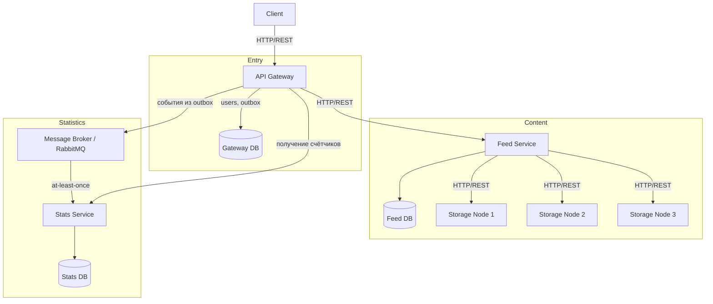
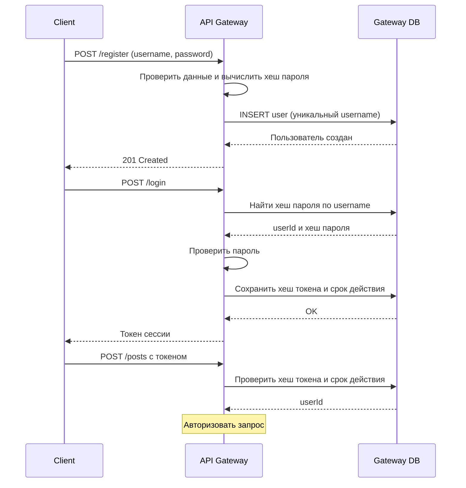
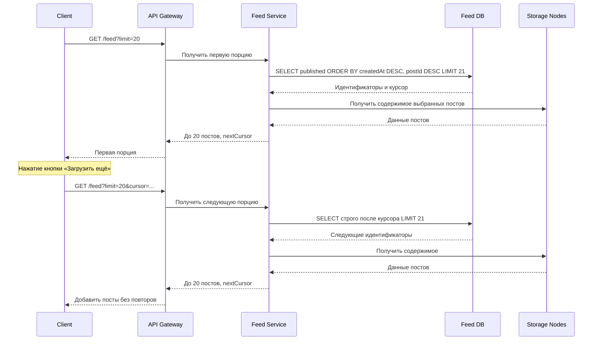
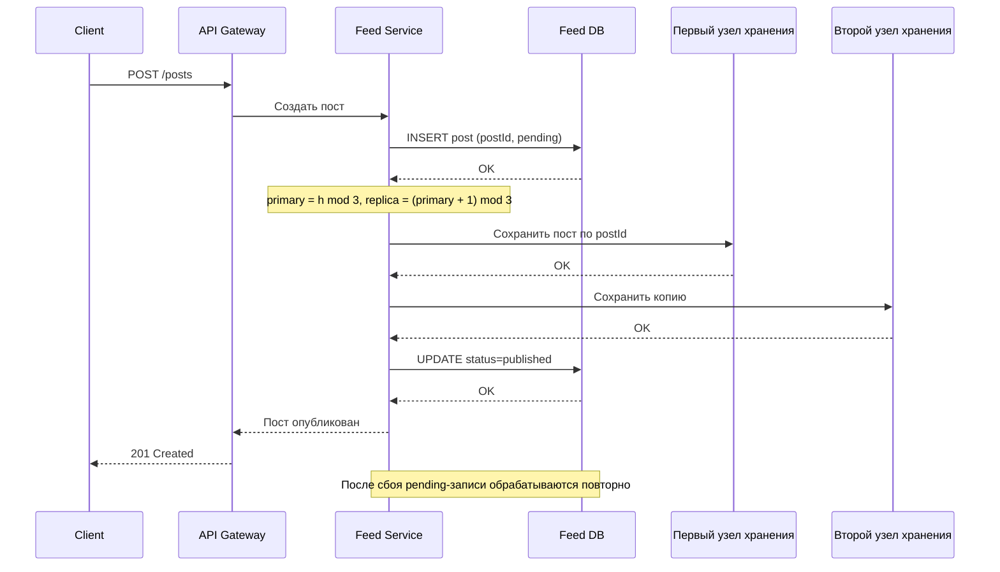
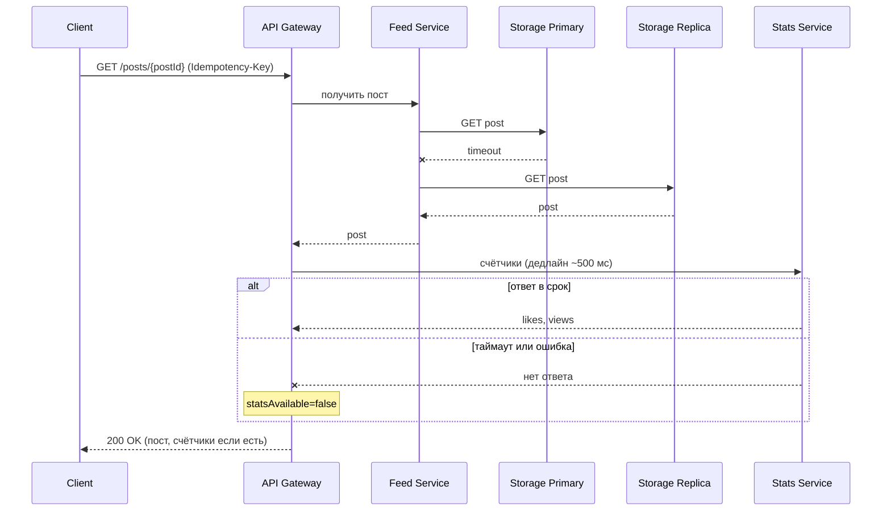
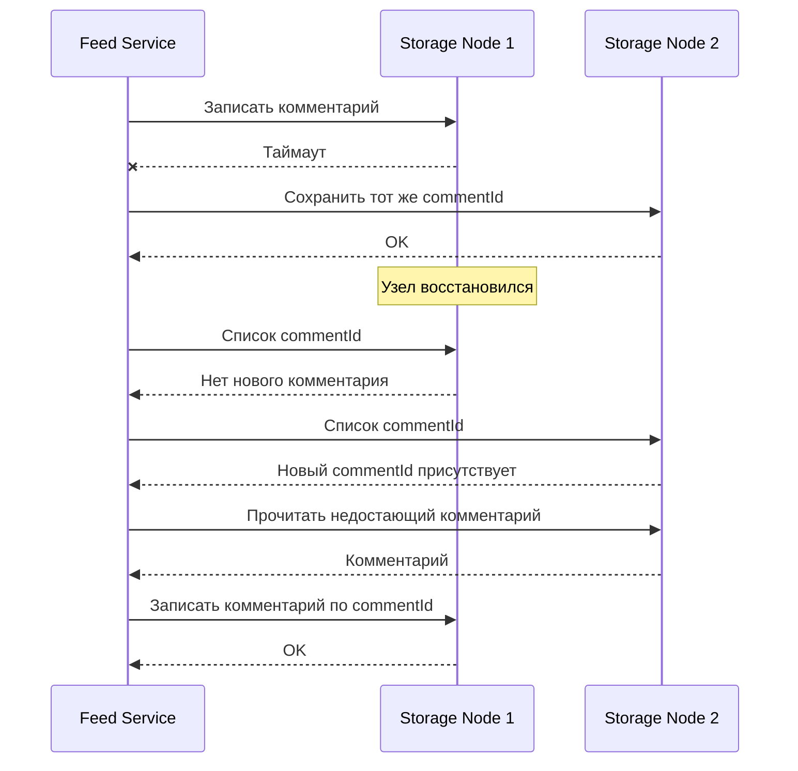
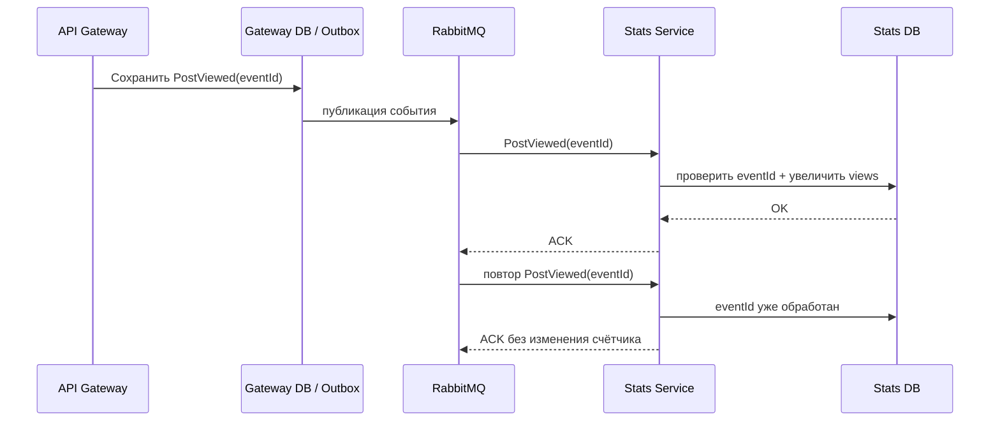
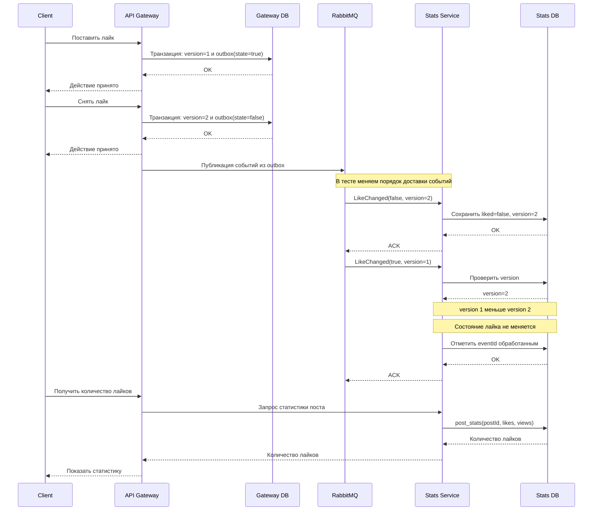

# Техническое решение проекта «MiniFeed»

## Введение
- **Краткое описание:**
 
  «MiniFeed» — учебный проект, в котором мы делаем прототип распределённой системы для публикации контента. Пользователи смотрят общую ленту и количество просмотров постов, а после регистрации и входа по имени и паролю создают короткие текстовые посты, ставят и убирают лайки и пишут комментарии.
Система разделена на несколько компонентов. Посты и комментарии хранятся на нескольких узлах хранения с копиями (репликами), а лайки и просмотры обрабатываются отдельным сервисом статистики через брокер сообщений. На этом примере мы показываем типичные проблемы распределённых систем: отказ одного узла, потерю и повторную доставку сообщений, разный порядок прихода событий и временную рассогласованность данных. 
- **Цель проекта:**  
  реализовать прототип распределённой платформы публикации контента, которая хранит посты на нескольких узлах, продолжает работать при отказе одного узла и корректно считает лайки и просмотры при повторной доставке и перестановке событий.
- **Задачи:**  
  •закрепить теорию по распределённым системам на практике;
  
  •разделить систему на несколько независимых компонентов;
  
  •распределить посты по узлам хранения и сделать их копии для отказоустойчивости;
  
  •передавать события лайков и просмотров асинхронно через брокер сообщений;
  
  •обработать ненадёжную и повторную доставку событий (at-least-once, идемпотентность, дедупликация);
  
  •обработать частичные отказы: недоступность узла хранения или сервиса статистики;
  
  •обработать разный порядок прихода событий (например, «снять лайк» пришло раньше «поставить лайк»);
  
  •использовать eventual consistency для данных, которым не нужна мгновенная согласованность (счётчики, копии постов).
- **Команда:**  
  •Бондаренко Артём Сергеевич, разработчик Feed Service (размещение данных, репликация, отказоустойчивость, лента)
  
  •Курбатская Злата Сергеевна, разработчик узлов хранения и комментариев
  
  •Рачугин Егор Олегович, разработчик событий и статистики (брокер, сервис статистики)
  
  •Баженова Наталья Антоновна, разработчик API Gateway, клиентского приложения, инфраструктуры и тестирования  

---

## Глоссарий

| Термин | Определение |
|---|---|
| Пользователь | Участник системы, который создаёт и просматривает посты, пишет комментарии и работает с лайками. |
| Учётная запись | Данные пользователя в системе: имя пользователя и пароль. |
| Имя пользователя | Уникальное в системе имя, по которому пользователь идентифицируется. |
| Пароль | Секретная строка, подтверждающая, что вход выполняет владелец учётной записи. |
| Пост | Созданная пользователем единица контента, содержащая текст. |
| Лента | Общий список постов, отображаемый пользователю в порядке от новых к старым. |
| Комментарий | Текстовое сообщение пользователя, относящееся к определённому посту. |
| Лайк | Положительная реакция пользователя на пост. |
| Просмотр | Факт открытия поста, который учитывается в статистике. |
| Статистика | Количество лайков и просмотров поста. |

---

## Функциональные требования

Система должна предоставлять следующие функции:

1. Регистрация пользователя.
2. Вход пользователя в систему.
3. Создание поста пользователем.
4. Просмотр общей ленты постов.
5. Просмотр отдельного поста.
6. Добавление лайка к посту.
7. Удаление ранее поставленного лайка.
8. Добавление комментария к посту.
9. Просмотр комментариев к посту.
10. Просмотр количества лайков поста.
11. Учёт просмотра поста.
12. Просмотр количества просмотров поста.

### Ограничения на предметную область

1. Посты и комментарии содержат только текст: пост — до 500 символов,
   комментарий — до 300 символов. Картинки, видео и файлы не
   поддерживаются.

2. Пользователь регистрируется, указав имя пользователя и пароль, и
   входит в систему с этими данными. Имя пользователя уникально:
   зарегистрировать второго пользователя с уже занятым именем нельзя. Имя
   регистрозависимое, длиной 3–15 символов. Пароль должен содержать от 6
   до 20 символов. Восстановление и смена пароля не поддерживаются.

3. Один пользователь может поставить на один пост не более одного
   лайка. Пользователь может убрать только свой лайк.

4. Посты и комментарии после создания нельзя редактировать или удалять.

5. Комментарии являются плоскими: ответить непосредственно на другой
   комментарий нельзя.

6. Используется одна общая лента. Персональные рекомендации,
   подписки, личные сообщения, поиск и теги не входят в текущий объём
   проекта.

7. Каждое открытие поста считается отдельным просмотром, в том числе
   повторное открытие того же поста.

8. Лента отображается порциями по 20 постов. Следующую порцию
   пользователь загружает явным действием — нажатием кнопки
   «Загрузить ещё» под последним отображаемым постом. Автоматической
   подгрузки при прокрутке нет. При подгрузке следующей порции уже
   показанные посты не должны дублироваться. Посты в каждой порции
   упорядочены от новых к старым.

9. Статистика лайков и просмотров может обновляться с небольшой
   задержкой. Пользовательские операции с контентом не должны зависеть
   от мгновенного обновления этих счётчиков.

10. Без входа доступны просмотр ленты, постов, комментариев и
    статистики. Создавать посты и комментарии, ставить и снимать лайки
    могут только вошедшие пользователи. При попытке выполнить такое
    действие без входа система сообщает об ошибке.

---

## Нефункциональные требования

### Надёжность

Основные пользовательские операции должны продолжать выполняться при
временном отказе отдельной части системы. Перечень таких операций
приведён в разделе «Отказоустойчивость».

Ошибка одной операции не должна приводить к потере уже сохранённых
данных.

### Асинхронность обработки

Обработка статистики не должна блокировать получение поста, ленты или
комментариев.

Задержка обработки статистики допустима, если она не нарушает
корректность итогового состояния.

### Сохранность операций

Операции, успешное принятие которых система подтвердила пользователю, не
должны теряться из-за временной остановки их дальнейшей обработки и
должны сохраняться до восстановления возможности их обработки.

Если принять операцию невозможно, пользователь получает сообщение об
ошибке.

После восстановления обработки накопленные операции должны быть
обработаны.

Повторная обработка уже обработанной операции не должна приводить
к повторному изменению итогового состояния.

### Идемпотентность

Повторная обработка одной и той же операции (в том числе при повторной
доставке сообщения о ней) должна давать тот же итоговый результат, что и
её однократная обработка.

Это относится и к повторной отправке одного и того же клиентского запроса: повтор с тем же идентификатором операции возвращает ранее принятый результат и не создаёт новых событий.

Требование относится именно к повторной обработке одной и той же операции,
а не к отдельным действиям пользователя с одинаковыми параметрами. Так,
два отдельных открытия одного поста являются двумя
просмотрами (см. ограничение 7), а повторная доставка операции об одном
открытии поста должна привести к учёту только одного просмотра.

В частности:

- повторная доставка операции о постановке лайка не должна создавать
  несколько лайков;
- повторная доставка операции о снятии лайка не должна изменять
  состояние после первой обработки;
- повторная доставка операции об одном открытии поста не должна
  приводить к учёту более одного просмотра;
- повторная обработка одной и той же операции не должна повторно
  изменять итоговое состояние.

### Корректность порядка операций

Для лайков: для действий одного пользователя над одним постом
(постановка и снятие лайка) система устанавливает порядок принятых
изменений. Итоговое состояние лайка должно соответствовать последнему
принятому изменению в этом порядке, даже если сообщения о них поступают
на обработку в другом порядке.

Для просмотров и комментариев: порядок поступления операций на обработку
не должен влиять на итоговый результат. Должны быть учтены все просмотры
поста (каждое открытие является отдельным просмотром) и сохранены все
комментарии пользователя, а не только последнее действие.

### Согласованность данных

Счётчики лайков и просмотров могут временно отличаться от фактического
состояния сразу после действия пользователя.

После завершения обработки накопленных операций статистика должна прийти
к актуальному значению.

Копии постов и комментариев на разных узлах хранения также могут временно
отличаться друг от друга. После восстановления узла и завершения
синхронизации ранее принятые посты и комментарии должны присутствовать на
всех предназначенных для них копиях.

### Отказоустойчивость

Отказ отдельной части системы не должен приводить к полной
недоступности основных пользовательских функций.

При отказе одного узла хранения пользователь по-прежнему может создавать
посты, просматривать ленту и отдельные посты, добавлять комментарии и
просматривать комментарии к постам, ставить и убирать лайки, а также
открывать посты с учётом просмотров.

При отказе одного узла хранения пользователь по-прежнему может
регистрироваться и входить в систему.

Согласование с НФТ: «доступность контента при отказе одного узла» гарантируется для данных, у которых обе копии синхронизированы. Для данных в деградированном режиме гарантируется сохранность на подтверждённой копии и сходимость после синхронизации.

При временной остановке обработки статистики пользователь по-прежнему
может создавать посты, просматривать ленту, отдельные посты и комментарии,
добавлять комментарии. Действия с лайками и открытия постов принимаются
системой и учитываются в статистике после восстановления обработки. При
этом значения счётчиков могут отставать от фактических.

При полной недоступности статистики значения счётчиков допускается
временно не показывать. Возможность принимать новые лайки и открытия
постов зависит от доступности компонента, который их сохраняет.

Если система не может безопасно принять операцию, она сообщает
пользователю об ошибке. Успешное создание поста, комментария или лайка не
показывается, если операция фактически не принята.

После восстановления работы системы накопленные данные и операции
должны быть обработаны без потери и без повторного изменения итогового
состояния.

### Предсказуемость поведения

Для одинаковой последовательности пользовательских действий система
должна выдавать одинаковый итоговый результат независимо от временных
задержек обработки.

### Защита паролей

Пароли не должны храниться в открытом виде и не передаются другим
пользователям. Для проверки паролей используются их защищённые хеши.

---

## Пользовательские сценарии

### Сценарий: регистрация

1. Пользователь вводит имя пользователя и пароль.
2. Клиентское приложение передаёт данные в систему.
3. Система проверяет, что имя не занято и данные соответствуют
   ограничениям.
4. Система создаёт учётную запись, пользователь получает подтверждение.
5. Если имя занято, система сообщает об ошибке, учётная запись не
   создаётся.

### Сценарий: вход пользователя

1. Пользователь вводит имя пользователя и пароль.
2. Система проверяет, что пароль соответствует учётной записи.
3. При совпадении пользователь получает доступ к функциям системы.
4. При несовпадении система сообщает об ошибке, доступ не
   предоставляется.

### Сценарий: создание поста

1. Пользователь выбирает создание нового поста и вводит текст.
2. Клиентское приложение отправляет запрос на создание поста.
3. Система сохраняет пост.
4. Пользователь получает подтверждение.
5. Пост появляется в общей ленте.

### Сценарий: просмотр общей ленты

1. Пользователь открывает общую ленту.
2. Клиентское приложение запрашивает список постов.
3. Система показывает первые 20 постов от новых к старым.
4. Пользователь просматривает ленту.
5. При необходимости пользователь нажимает кнопку «Загрузить ещё».
6. Система загружает следующую порцию из 20 постов и добавляет её к
   уже отображаемой ленте.

### Сценарий: просмотр поста

1. Пользователь выбирает пост в ленте.
2. Клиентское приложение запрашивает пост.
3. Система возвращает содержимое поста, количество лайков и количество
   просмотров.
4. Открытие поста учитывается как отдельный просмотр.
5. При повторном открытии того же поста также фиксируется новый
   просмотр.
6. После завершения обработки событий счётчики приходят к актуальным
   значениям. Сразу после действия допускается небольшая задержка.

### Сценарий: добавление лайка

1. Пользователь открывает пост и нажимает «Нравится».
2. Клиентское приложение отправляет запрос на добавление лайка.
3. Система сохраняет лайк пользователя для выбранного поста.
4. Пользователь видит, что лайк установлен.

### Сценарий: удаление лайка

1. Пользователь открывает пост, которому ранее поставил лайк, и
   нажимает «Убрать лайк».
2. Клиентское приложение отправляет запрос на удаление лайка.
3. Система удаляет лайк пользователя для выбранного поста.
4. Пользователь видит, что его лайк снят.

### Сценарий: добавление комментария

1. Пользователь открывает пост и вводит текст комментария.
2. Клиентское приложение отправляет запрос на создание комментария.
3. Система сохраняет комментарий, связанный с постом и пользователем.
4. Пользователь получает подтверждение.
5. Комментарий становится виден в списке комментариев поста.

### Сценарий: просмотр комментариев

1. Пользователь открывает пост.
2. Клиентское приложение запрашивает комментарии к посту.
3. Система возвращает список комментариев от старых к новым.
4. Пользователь видит комментарии.

---

## Архитектура системы

Для реализации проекта выбирается небольшая сервисная архитектура, которую можно полностью запустить локально через Docker Compose. Основная логика распределённости реализуется на уровне наших сервисов, а не перекладывается целиком на готовую распределённую СУБД.

Основные компоненты:

1. **Client** — простое веб-приложение пользователя. Позволяет зарегистрироваться и войти в систему, просматривать ленту и отдельные посты, создавать посты и комментарии, ставить и снимать лайки. Для каждого действия (открытие поста, лайк, создание поста или комментария) клиент генерирует clientOpId (UUID) и передаёт его в заголовке Idempotency-Key. При повторной отправке того же действия используется тот же clientOpId.
2. **API Gateway** — единая точка входа для клиентских запросов. Проверяет авторизацию, маршрутизирует запросы в остальные компоненты, формирует уникальные идентификаторы операций и сохраняет события лайков и просмотров перед их асинхронной отправкой.
3. **Gateway DB** — локальная база API Gateway. Хранит учётные записи пользователей, защищённые хеши паролей, сессии с ограниченным сроком действия, outbox для событий лайков и просмотров и версии принятых операций лайка для каждой пары пользователь–пост, а также таблицу принятых клиентских операций (userId, clientOpId) → requestHash, результат (eventId, likeVersion, ответ) с уникальным ограничением на пару.
4. **Feed Service** — сервис работы с постами, комментариями и общей лентой. Выбирает узлы хранения для поста, выполняет запись копий, переключается на доступную копию при отказе узла и запускает восстановление недостающих копий.
5. **Feed DB** — локальная база Feed Service. Хранит индекс общей ленты и служебную информацию о постах. При создании поста сначала сохраняется запись со статусом pending: postId, автор, текст и время создания. Нормальный режим: обе предназначенные записи подтверждены. Только после этого клиент получает подтверждение, а пост считается полностью реплицированным. Деградированный режим: подтверждение разрешено после записи на один узел, только если второй узел признан недоступным (таймаут или ошибка соединения). До подтверждения Feed Service durably сохраняет в Feed DB отметку «копия на узле X отсутствует». Если записать не удалось ни на один узел, клиент получает ошибку, подтверждения нет. В ленту попадают только опубликованные посты. После перезапуска Feed Service повторно обрабатывает незавершённые записи pending с прежним postId; основными копиями содержимого служат данные на Storage Node. Создание постов и комментариев: шлюз передаёт clientOpId в Feed Service. Feed Service в Feed DB создаёт запись операции (clientOpId, requestHash, objectType, objectId, status=PENDING) с заранее сгенерированным postId или commentId. Затем он пишет объект на узлы (запись идемпотентна по id), добавляет пост в индекс ленты и только после этого переводит операцию в COMPLETED. Повтор с COMPLETED возвращает сохранённый результат. Повтор с PENDING не возвращает id как готовый результат, а продолжает операцию с теми же id: повторяет недостающие записи на узлы и добавление в индекс (все шаги идемпотентны), затем ставит COMPLETED. Если ни одну запись на узел выполнить не удаётся, клиент получает ошибку, а операция остаётся PENDING и может быть завершена повтором. Журнал незавершённой репликации: в Feed DB хранится единый журнал (objectType = post | comment, objectId, postId, targetNode, status = MISSING | REPAIRED). Запись создаётся до подтверждения клиенту в деградированном режиме. Индекс ленты подтверждает только существование поста, но не наличие конкретного комментария, поэтому для комментариев ориентиром служит журнал. Фоновая синхронизация и read repair обрабатывают записи обоих типов. При чтении комментариев Feed Service дополнительно сверяет наборы commentId на двух узлах и использует их объединение. Запись получает статус REPAIRED после подтверждённой записи на целевой узел.
6. **Storage Node 1..3** — три одинаковых узла хранения. Каждый узел имеет собственную локальную базу и хранит часть постов и комментариев.
7. **Message Broker** — RabbitMQ. Используется для асинхронной передачи событий лайков и просмотров.
8. **Stats Service** — сервис статистики. Получает события из брокера, выполняет дедупликацию и обновляет состояние лайков и счётчики просмотров.
9. **Stats DB** — таблицы like_state(userId, postId, liked, version) и post_stats(postId, likes, views). Событие LikeChanged обрабатывается одной транзакцией: если version больше сохранённой, то обновляются liked и version, счётчик likes меняется на ±1 только при реальном переходе состояния, и eventId помечается обработанным. Если версия не больше сохранённой, событие игнорируется.

**Планируемый стек:** Python и FastAPI для HTTP-сервисов, SQLite для локальной базы каждого компонента, RabbitMQ для очереди событий, HTML/CSS/JavaScript без отдельного фронтенд-фреймворка для клиента, Docker Compose для локального запуска и pytest для автоматических тестов. Фоновая отправка outbox и синхронизация копий выполняются внутри существующих сервисов: отдельные компоненты ради этих задач не создаются. Стек предполагается согласовать внутри команды перед реализацией; он выбран для минимизации сложности учебного прототипа.

### Размещение постов, репликация и восстановление копий

- **Проблема:** при отказе одного узла посты и комментарии должны оставаться доступны, а после восстановления узла копии данных должны синхронизироваться.
- **Размещение:** три Storage Node, основной узел поста выбирается стабильной функцией: h = int.from_bytes(sha256(postId.encode("utf-8")).digest()[:8], "big"), primary = h mod 3, replica = (primary + 1) mod 3 (встроенная hash() Python не используется, формула едина для всего документа). Комментарии хранятся на тех же узлах, что и пост.
- **Запись:** Нормальный режим: обе предназначенные записи подтверждены. Только после этого клиент получает подтверждение, а пост считается полностью реплицированным. Деградированный режим: подтверждение разрешено после записи на один узел, только если второй узел признан недоступным (таймаут или ошибка соединения). До подтверждения Feed Service durably сохраняет в Feed DB отметку «копия на узле X отсутствует». Если записать не удалось ни на один узел, клиент получает ошибку, подтверждения нет.
- **Чтение поста:** сначала проверяется первый узел. Если он не отвечает в пределах таймаута или пост отсутствует, Feed Service читает со второго. Посты после создания не изменяются, поэтому конфликтов версий текста не возникает.
- **Чтение комментариев:** Feed Service запрашивает комментарии с обоих доступных узлов и объединяет результаты по commentId без дублей. Список сортируется по времени создания и commentId от старых к новым. Если один узел недоступен, используется второй; после возвращения устаревшего узла объединение не скрывает уже сохранённые комментарии.
- **Фоновая синхронизация:** Feed Service периодически сверяет идентификаторы постов и комментариев на назначенных узлах и копирует отсутствующие записи с доступной копии. Проверка выполняется независимо от пользовательских запросов, включая время после восстановления узла: сначала восстанавливается пост, затем его комментарии.
- **Read repair:** при обнаружении недостающей копии во время чтения Feed Service также может восстановить её сразу. Фоновая синхронизация обеспечивает восстановление и без чтений.
- **Отказоустойчивость:** первый узел является только предпочтительным для чтения, а не единственным мастером. Оба узла могут принимать идемпотентные записи неизменяемых объектов. При таймауте используется второй узел без выбора лидера, fencing или распределённого консенсуса. Это не single-master replication с автоматическим переключением мастера.
- **Гарантия:** Допустимая последовательность отказов: в каждый момент отказывает не более одного узла, и между двумя отказами восстановление успевает завершиться. Гарантия восстановления предполагает сохранность локального хранилища отказавшего узла (например, остановка контейнера при сохранном Docker volume). При потере диска или удалении данных единственной подтверждённой копии она не восстанавливается. Последовательные отказы до восстановления второй копии, а также одновременный отказ двух узлов в гарантии не покрываются. Если единственный держатель копии временно недоступен, объект временно недоступен для чтения, а после возвращения узла с сохранным хранилищем снова читается.
- Журнал незавершённой репликации: в Feed DB хранится единый журнал (objectType = post | comment, objectId, postId, targetNode, status = MISSING | REPAIRED). Запись создаётся до подтверждения клиенту в деградированном режиме. Индекс ленты подтверждает только существование поста, но не наличие конкретного комментария, поэтому для комментариев ориентиром служит журнал. Фоновая синхронизация и read repair обрабатывают записи обоих типов. При чтении комментариев Feed Service дополнительно сверяет наборы commentId на двух узлах и использует их объединение. Запись получает статус REPAIRED после подтверждённой записи на целевой узел.
- Граница гарантии после возвращения узла: вернувшийся узел не считается полноценной резервной копией, пока для него есть незакрытые отметки восстановления. Пока они есть, Feed Service не принимает ответ «не найдено» с такого узла как окончательный (пост есть в индексе ленты, а для комментария есть открытая запись журнала). Он читает с узла, где копия подтверждена, и запускает read repair. Отметка снимается после записи недостающей копии.
- Согласование с НФТ: «доступность контента при отказе одного узла» гарантируется для данных, у которых обе копии синхронизированы. Для данных в деградированном режиме гарантируется сохранность на подтверждённой копии и сходимость после синхронизации.
- **Компромиссы:** во время отказа некоторые записи временно имеют одну копию. Одновременный отказ двух узлов, потеря Feed DB и динамическое добавление узлов с перераспределением данных не поддерживаются.

### Стабильная функция выбора узлов

Проблема: встроенная функция hash() в Python для строк даёт разные значения в разных запусках процесса (из-за случайной соли), поэтому один и тот же пост мог бы отображаться на разные узлы после перезапуска Feed Service.

Решение: h = int.from_bytes(sha256(postId.encode("utf-8")).digest()[:8], "big"), primary = h mod 3, replica = (primary + 1) mod 3. Встроенная hash() не используется.

Единая формула: именно эта запись используется во всех разделах документа, в коде и в тестах; других вариантов (например, хеш целиком) нет.

Гарантия: выбор пары узлов зависит только от postId и не меняется между запусками, процессами и контейнерами.

Тест: для набора фиксированных postId ожидаемые пары узлов заданы в тесте как эталон; пара совпадает между перезапусками процесса; replica всегда отличается от primary.

### Асинхронная доставка событий и outbox

- **Проблема:** RabbitMQ и Stats Service могут временно быть недоступны; сообщение может задержаться или быть доставлено повторно. Потеря подтверждения не означает, что операция не была обработана.
- **Решение:** API Gateway сначала сохраняет принятое событие с уникальным eventId в локальной таблице outbox. Фоновый отправитель публикует его в RabbitMQ. Если брокер недоступен или подтверждение публикации не пришло, запись остаётся в outbox для повторной отправки.
- **Сохранность сообщения:** применяется долговременная очередь RabbitMQ (durable queue) и сохраняемые на диск сообщения (persistent messages). Отправитель использует publisher confirms и отмечает запись как отправленную лишь после подтверждения брокера.
- **Обработка:** Stats Service использует manual ACK и подтверждает сообщение после фиксации результата в Stats DB. При ошибке сообщение не подтверждается, поэтому после восстановления потребителя может быть доставлено повторно.
- **Дедупликация:** в одной транзакции Stats DB выполняются проверка eventId, изменение статистики и запись обработанного eventId. Если тот же eventId уже известен, состояние не меняется, но доставка также подтверждается.
- **Гарантия:** при временной недоступности RabbitMQ или Stats Service ранее принятые события не теряются при сохранности локальных данных и догоняют статистику после восстановления; повторная доставка не приводит к повторному учёту.
- **Компромиссы:** используется at-least-once, поэтому дубли возможны. Статистика обновляется с задержкой. Потеря постоянных данных Gateway DB или RabbitMQ не покрывается гарантиями учебного прототипа.

### Порядок операций с лайком

Проблема: события «поставить» и «снять лайк» могут прийти в обратном порядке.

Реализация: likeVersion на пару userId–postId присваивается атомарно в Gateway DB (транзакция с блокировкой записи, хранится последнее принятое состояние). Stats Service в одной транзакции обновляет версию, состояние лайка и счётчик, применяя событие только при версии выше сохранённой.

Гарантия: итоговое состояние лайка соответствует последней принятой операции. Порядок устанавливается одним шлюзом, а кластер шлюзов вне объёма проекта.

Компромиссы: порядок задаётся одним API Gateway с одной локальной базой. Кластер шлюзов вне объёма проекта.

### Идемпотентность клиентских запросов

Проблема: ответ API Gateway клиенту может потеряться, и клиент повторит запрос. Без общего идентификатора операции шлюз не отличит повтор от нового действия. Тогда повторное открытие даст второй просмотр, а повтор старого «поставить лайк» после «снять лайк» снова установит лайк.

Решение: clientOpId создаёт клиент. Шлюз в одной локальной транзакции Gateway DB делает следующее:

- проверяет пару (userId, clientOpId);
- если пара уже есть, возвращает сохранённый результат без побочных эффектов;
- если пары нет, то при изменении состояния увеличивает likeVersion, создаёт событие с eventId и пишет его в outbox, а при неизменном состоянии версию и событие не создаёт;
- в любом случае сохраняет операцию с requestHash и результатом. Повтор возвращает именно первоначальный результат.

Если пара есть, но requestHash не совпадает, возвращается 409 Conflict. Уникальное ограничение исключает гонку двух одновременных повторов. Запрос лайка несёт желаемое состояние (liked=true/false). Если принятое состояние уже совпадает, новая версия не создаётся, но сама операция всё равно сохраняется с clientOpId и результатом «без изменений».

Контроль параметров повтора: вместе с операцией хранится requestHash, то есть SHA-256 от канонической записи параметров (тип операции, postId, желаемое состояние лайка или текст). Если приходит тот же clientOpId, но с другим requestHash (другой postId, другое состояние лайка, другой текст), система возвращает 409 Conflict и ничего не меняет.

Создание постов и комментариев: шлюз передаёт clientOpId в Feed Service. Feed Service в Feed DB создаёт запись операции (clientOpId, requestHash, objectType, objectId, status=PENDING) с заранее сгенерированным postId или commentId. Затем он пишет объект на узлы (запись идемпотентна по id), добавляет пост в индекс ленты и только после этого переводит операцию в COMPLETED. Повтор с COMPLETED возвращает сохранённый результат. Повтор с PENDING не возвращает id как готовый результат, а продолжает операцию с теми же id: повторяет недостающие записи на узлы и добавление в индекс (все шаги идемпотентны), затем ставит COMPLETED. Если ни одну запись на узел выполнить не удаётся, клиент получает ошибку, а операция остаётся PENDING и может быть завершена повтором.

Гарантия: повтор одного клиентского запроса, а не только повторная доставка события, не создаёт второй просмотр, второй лайк, новую likeVersion или дубль поста/комментария. Два отдельных действия имеют разные clientOpId и учитываются отдельно.

Компромиссы: clientOpId хранятся ограниченное время (например, 24 часа). Повтор позже не покрывается гарантией. Повтор устаревшего запроса возвращает исходный сохранённый ответ, а текущее состояние не меняется.

### Атомарное версионирование лайков

Проблема: даже один API Gateway может обрабатывать два запроса по одной паре userId–postId одновременно. Оба могут прочитать одну и ту же версию и назначить одинаковую likeVersion, а состояние окажется неопределённым.

Решение в Gateway DB: таблица like_state(userId, postId, liked, version) с первичным ключом по паре. Принятие операции выполняется в одной транзакции с немедленной блокировкой записи (SQLite: BEGIN IMMEDIATE). Внутри транзакции шлюз: (1) проверяет clientOpId; (2) читает строку (если строки нет, считается liked=false, version=0); (3) если желаемое состояние совпадает с сохранённым, сохраняет операцию с clientOpId, requestHash и результатом «без изменений» (без новой версии и события) и возвращает этот результат; (4) иначе записывает liked и version+1, создаёт событие в outbox и сохраняет принятую операцию. Любая принятая операция сохраняется, даже если она не изменила состояние. Записи сериализуются, поэтому версии для пары строго возрастают без дублей.

Решение в Stats DB: таблицы like_state(userId, postId, liked, version) и post_stats(postId, likes, views). Событие LikeChanged обрабатывается одной транзакцией: если version больше сохранённой, то обновляются liked и version, счётчик likes меняется на ±1 только при реальном переходе состояния, и eventId помечается обработанным. Если версия не больше сохранённой, событие игнорируется.

Гарантия: итоговое состояние лайка соответствует операции с максимальной принятой версией, а likes равен числу пар с liked=true. Это верно при повторной доставке, перестановке событий и одновременных запросах.

Компромиссы: порядок задаётся одним API Gateway с одной локальной базой. Кластер шлюзов вне объёма проекта.

### Учёт просмотров

- **Проблема:** два разных открытия одного поста должны считаться двумя просмотрами, однако повторная доставка события одного открытия не должна увеличивать счётчик дважды.
- **Решение:** для каждого открытия создаётся новый eventId. При повторной доставке сохраняется тот же eventId.
- **Обработка:** Stats Service увеличивает счётчик только для ранее не обработанного eventId.
- **Гарантия:** два отдельных открытия дают два просмотра, а повторная доставка одного события учитывается один раз.
- **Компромиссы:** просмотры считаются по факту открытия поста, а не по уникальным пользователям.

### Частичные отказы и eventual consistency

- **Проблема:** отдельный узел хранения или компонент статистики может перестать отвечать, тогда как остальная система работает.
- **Отказ узла хранения:** Feed Service ограничивает ожидание HTTP-запросов таймаутом. Если один из назначенных узлов недоступен, чтение и запись продолжаются через второй. После восстановления недостающие копии возвращаются фоновой синхронизацией.
- **Отказ Stats Service:** регистрация, вход, лента, посты и комментарии продолжают работать. События лайков и просмотров сохраняются в outbox API Gateway, а после восстановления Stats Service доходят до обработки. Счётчики временно могут не отображаться.
- Решение: любой запрос шлюза к Stats Service выполняется с коротким общим дедлайном (например, 300–500 мс, с учётом connect и read). Для ленты счётчики 20 постов запрашиваются одним batch-запросом под одним дедлайном. При таймауте или ошибке шлюз возвращает контент без счётчиков с признаком statsAvailable=false, а клиент показывает «—». Правило действует для ленты, отдельного поста и любых других путей, где запрашиваются счётчики. Создание события просмотра не зависит от Stats Service, потому что оно пишется в outbox.
- Гарантия: время ответа на чтение контента ограничено сверху дедлайном статистики плюс время чтения контента, даже если Stats Service принимает соединения, но не отвечает.
- **Отказ RabbitMQ:** принятые события остаются в outbox и повторно публикуются после восстановления брокера. Обновление статистики не блокирует работу с контентом.
- **Гарантия:** при отдельном отказе одного Storage Node либо временной остановке Stats Service или RabbitMQ сохраняется заявленная доступность пользовательских операций. После восстановления и обработки очереди копии данных и статистика сходятся.
- **Компромиссы:** короткий таймаут ускоряет переключение, но может принять медленный узел за отказавший. API Gateway, Feed Service и их SQLite-базы не имеют резервных экземпляров. Одновременный отказ двух узлов хранения не поддерживается.

---

## Технические сценарии

### Сценарий: регистрация и вход пользователя

1. Клиент отправляет `POST /register` с именем пользователя и паролем.
2. API Gateway проверяет ограничения на длину имени и пароля, создаёт `userId` и защищённый хеш пароля с индивидуальной солью (Argon2id).
3. API Gateway пытается сохранить пользователя в Gateway DB. Уникальное ограничение на поле `username` не позволяет одновременно создать две учётные записи с одним именем. При конфликте возвращается ошибка регистрации.
4. Для входа клиент отправляет `POST /login` с именем и паролем. API Gateway получает хеш из Gateway DB и проверяет пароль.
5. При успешной проверке API Gateway создаёт случайный токен сессии, сохраняет в Gateway DB его хеш, `userId` и срок действия; сам токен возвращает клиенту.
6. При создании поста, комментария или изменении лайка клиент передаёт токен в заголовке `Authorization`. API Gateway проверяет срок действия сессии и соответствие хеша токена в Gateway DB.
7. Если имя занято, пароль неверен или сессия недействительна, соответствующая операция отклоняется. Просмотр публичных постов и ленты не требует входа.

### Сценарий: получение общей ленты с пагинацией

1. Клиент отправляет `GET /feed?limit=20` в API Gateway, который передаёт запрос в Feed Service.
2. Feed Service выбирает в Feed DB опубликованные посты (`status=published`), отсортированные по `createdAt DESC, postId DESC`. Выбирается до 21 записи: 20 для выдачи, дополнительная запись для определения наличия следующей порции.
3. По `postId` Feed Service определяет два узла хранения каждого поста и загружает текст с доступной копии. При таймауте основного узла используется резервный.
4. Feed Service возвращает до 20 постов и, если есть следующая порция, курсор на основе пары `createdAt` и `postId` последней выданной записи.
5. После нажатия кнопки «Загрузить ещё» клиент отправляет `GET /feed?limit=20&cursor={cursor}`.
6. Feed Service выбирает записи строго после курсора: с меньшим `createdAt`, либо с тем же `createdAt` и меньшим `postId`. Клиент добавляет полученную порцию к уже показанной ленте.
7. Если дополнительных записей нет, сервер возвращает признак окончания ленты. Новые публикации, появившиеся между запросами, не дублируют ранее показанные посты.

Решение: любой запрос шлюза к Stats Service выполняется с коротким общим дедлайном (например, 300–500 мс, с учётом connect и read). Для ленты счётчики 20 постов запрашиваются одним batch-запросом под одним дедлайном. При таймауте или ошибке шлюз возвращает контент без счётчиков с признаком statsAvailable=false, а клиент показывает «—». Правило действует для ленты, отдельного поста и любых других путей, где запрашиваются счётчики. Создание события просмотра не зависит от Stats Service, потому что оно пишется в outbox.

Гарантия: время ответа на чтение контента ограничено сверху дедлайном статистики плюс время чтения контента, даже если Stats Service принимает соединения, но не отвечает.

### Сценарий: создание поста с репликацией

1. Авторизованный клиент отправляет POST /posts с текстом поста в API Gateway.
2. API Gateway проверяет авторизацию пользователя и передаёт запрос в Feed Service.
3. Feed Service создаёт уникальный postId и сохраняет информацию о посте в Feed DB со статусом pending.
4. h = int.from_bytes(sha256(postId.encode("utf-8")).digest()[:8], "big"), primary = h mod 3, replica = (primary + 1) mod 3. Встроенная hash() не используется.
5. Нормальный режим: обе предназначенные записи подтверждены. Только после этого клиент получает подтверждение, а пост считается полностью реплицированным.
6. Деградированный режим: подтверждение разрешено после записи на один узел, только если второй узел признан недоступным (таймаут или ошибка соединения). До подтверждения Feed Service durably сохраняет в Feed DB отметку «копия на узле X отсутствует». Если записать не удалось ни на один узел, клиент получает ошибку, подтверждения нет.
7. В общей ленте отображаются только посты со статусом published.
8. API Gateway возвращает клиенту подтверждение успешного создания поста только после перехода в состояние published.
9. Если Feed Service отключается во время создания поста, после перезапуска он находит записи со статусом pending и повторяет незавершённые операции с теми же postId.
10. Если ни один из предназначенных узлов хранения не подтвердил сохранение поста, публикация не считается завершённой и пользователь не получает сообщение об успешном создании поста.

### Сценарий: чтение поста при отказе основного узла

1. Клиент запрашивает GET /posts/{postId}.
2. API Gateway передаёт запрос в Feed Service.
3. Feed Service определяет основной узел и реплику для postId.
4. Основной узел не отвечает до истечения таймаута.
5. Feed Service обращается к реплике и получает пост.
6. API Gateway дополнительно запрашивает текущие счётчики у Stats Service. Если статистика недоступна, пост возвращается без счётчиков.
7. Клиент получает пост.
8. После восстановления основного узла фоновая синхронизация восстанавливает недостающую копию даже без новых запросов на чтение поста.

Решение: любой запрос шлюза к Stats Service выполняется с коротким общим дедлайном (например, 300–500 мс, с учётом connect и read). Для ленты счётчики 20 постов запрашиваются одним batch-запросом под одним дедлайном. При таймауте или ошибке шлюз возвращает контент без счётчиков с признаком statsAvailable=false, а клиент показывает «—». Правило действует для ленты, отдельного поста и любых других путей, где запрашиваются счётчики. Создание события просмотра не зависит от Stats Service, потому что оно пишется в outbox.

Гарантия: время ответа на чтение контента ограничено сверху дедлайном статистики плюс время чтения контента, даже если Stats Service принимает соединения, но не отвечает.

### Сценарий: создание комментария при недоступности одной копии

1. Авторизованный клиент отправляет POST /posts/{postId}/comments.
2. Feed Service по postId определяет два узла, на которых должны находиться пост и его комментарии.
3. Комментарий получает уникальный commentId.
4. Feed Service пытается записать комментарий на оба узла.
5. Если один узел недоступен, комментарий сохраняется на доступном узле; недостающая копия восстанавливается при фоновой синхронизации.
6. После возвращения узла недостающий комментарий копируется на него.
7. Повторное сохранение того же commentId не создаёт второй комментарий.

### Сценарий: восстановление узла хранения

1. Один из двух узлов хранения, на которых размещён пост, перестаёт отвечать. Feed Service использует оставшуюся доступную копию.
2. Пока первый узел недоступен, пользователь создаёт комментарий; запись с уникальным commentId сохраняется на втором узле.
3. Первый узел возвращается в работу, но ещё не содержит новый комментарий.
4. При фоновой синхронизации Feed Service сравнивает идентификаторы записей на двух предназначенных узлах.
5. Сервис копирует недостающий комментарий на восстановленный узел с прежним commentId. Повторное сохранение не создаёт дубликат.
6. После завершения синхронизации копии содержат одинаковые наборы постов и комментариев.

### Сценарий: просмотр поста и повторная доставка события

1. Клиент запрашивает пост.
2. После получения содержимого поста API Gateway создаёт для этого открытия новый eventId и сохраняет событие PostViewed в outbox до подтверждения открытия клиенту.
3. Фоновый отправитель передаёт событие в RabbitMQ.
4. RabbitMQ доставляет событие Stats Service. При отсутствии подтверждения доставка может повториться.
5. Stats Service в одной транзакции проверяет eventId, увеличивает счётчик просмотров и отмечает eventId обработанным.
6. Если то же событие приходит повторно, его eventId уже существует и счётчик второй раз не увеличивается.
7. При следующем отдельном открытии создаётся другой eventId, поэтому новый просмотр учитывается.

### Сценарий: лайк и снятие лайка приходят в обратном порядке

1. Авторизованный пользователь ставит лайк посту. API Gateway принимает действие и определяет для пары userId–postId следующую версию likeVersion=1.
2. API Gateway одной транзакцией сохраняет новую версию и событие LikeChanged(state=true, version=1) в outbox.
3. Пользователь снимает лайк с того же поста. API Gateway принимает действие и сохраняет LikeChanged(state=false, version=2) вместе с новой версией.
4. Фоновый отправитель передаёт события из outbox в RabbitMQ.
5. Из-за задержек или повторной доставки Stats Service сначала получает событие с version=2.
6. Stats Service проверяет текущую версию для пары userId–postId. Поскольку более новой версии ещё нет, сервис сохраняет liked=false и version=2.
7. Затем Stats Service получает событие с version=1.
8. Сервис сравнивает версии и обнаруживает, что version=1 меньше сохранённой version=2. Устаревшее событие не изменяет состояние лайка.
9. Обработка каждого события и сохранение его eventId выполняются в одной локальной транзакции.
10. Решение в Stats DB: таблицы like_state(userId, postId, liked, version) и post_stats(postId, likes, views). Событие LikeChanged обрабатывается одной транзакцией: если version больше сохранённой, то обновляются liked и version, счётчик likes меняется на ±1 только при реальном переходе состояния, и eventId помечается обработанным. Если версия не больше сохранённой, событие игнорируется.
11. Итоговое состояние соответствует последнему принятому действию пользователя: лайк снят, и пользователь не учитывается в количестве лайков поста.

### Сценарий: временная остановка Stats Service

1. Stats Service останавливается.
2. Пользователь продолжает просматривать посты, создавать посты и комментарии.
3. События просмотров и лайков сохраняются в outbox и передаются в RabbitMQ, где ожидают обработки.
4. Содержимое постов и комментариев остаётся доступным. Значения счётчиков могут быть устаревшими или временно не отображаться.
5. Stats Service запускается снова.
6. Он получает накопившиеся события из RabbitMQ.
7. Дубликаты отбрасываются по eventId, а события лайков применяются с учётом likeVersion.
8. После обработки очереди статистика приходит к актуальному состоянию.

---

## План разработки и тестирования

### План разработки

1. **Подготовка инфраструктуры**
   - создать структуру сервисов;
   - настроить Docker Compose;
   - добавить RabbitMQ и постоянные тома для локальных баз.

2. **API Gateway и пользователи**
   - реализовать регистрацию и вход;
   - хранить пароли только в виде защищённых хешей;
   - реализовать проверку авторизации для действий, требующих входа;
   - реализовать создание и проверку сессий с ограниченным сроком действия;
   - реализовать outbox и генерацию eventId;
   - реализовать версии операций лайка для пары userId–postId.

3. **Storage Node**
   - реализовать единый сервис узла хранения;
   - реализовать хранение постов и комментариев;
   - обеспечить идемпотентную запись по postId и commentId;
   - запускать три экземпляра сервиса с независимыми локальными базами.

4. **Feed Service**
   - реализовать создание postId и размещение постов по SHA-256;
   - реализовать две копии каждого поста и комментариев;
   - реализовать индекс общей ленты и загрузку по 20 постов;
   - реализовать таймаут и переключение на вторую копию;
   - реализовать фоновую синхронизацию копий и read repair.

5. **Stats Service**
   - подключить RabbitMQ;
   - реализовать обработку PostViewed и LikeChanged;
   - реализовать дедупликацию по eventId;
   - реализовать обработку likeVersion;
   - реализовать выдачу количества просмотров и лайков.

6. **Клиентское приложение**
   - реализовать регистрацию и вход;
   - реализовать общую ленту и кнопку «Загрузить ещё»;
   - реализовать просмотр и создание постов;
   - реализовать комментарии;
   - реализовать постановку и снятие лайка;
   - корректно отображать состояние, когда статистика временно недоступна.

7. **Интеграция и подготовка демонстрации**
   - связать все компоненты;
   - добавить подготовку тестовых данных;
   - добавить сценарии остановки отдельных компонентов;
   - описать команды запуска и демонстрации в README.

### План тестирования

- **Функциональные тесты**
  - регистрация пользователя с уникальным именем и отказ при занятом имени;
  - успешный и неуспешный вход, проверка срока действия токена;
  - отказ в создании поста, комментария или изменении лайка без авторизации;
  - создание и просмотр поста, создание и просмотр комментариев;
  - загрузка ленты порциями по 20 постов без дублей, в том числе если между запросами появился новый пост;
  - постановка и снятие лайка.

- **Тесты распределения, репликации и восстановления**
  - один postId при повторных вычислениях и после перезапуска Feed Service соответствует одной и той же паре узлов;
  - разные postId распределяются между тремя узлами по SHA-256;
  - новый пост и комментарии к нему при исправных узлах имеют по две копии;
  - при остановке одного Storage Node чтение поста и создание нового поста или комментария продолжают работать;
  - после восстановления Storage Node фоновая синхронизация возвращает недостающие посты и комментарии даже без пользовательских запросов;
  - если отстающий узел вновь доступен, чтение комментариев объединяет данные двух копий без пропусков и дублей;
  - Feed Service останавливается после сохранения поста на Storage Node, но до смены pending на published: после перезапуска публикация завершается и появляется в ленте один раз.
  - нормальный режим: пост подтверждается только после двух записей и находится на двух узлах;
  - остановить узел B, создать пост (подтверждение, в Feed DB есть отметка), вернуть B, дождаться синхронизации, остановить A: пост читается с B;
  - после возврата B до синхронизации запрос поста не возвращает «не найдено», а читает с A;
  - оба узла недоступны: создание поста возвращает ошибку, пост в ленте не появляется;
  - остановить узел B, создать комментарий к существующему посту, вернуть B: после синхронизации комментарий есть на обоих узлах, запись журнала с objectType=comment имеет статус REPAIRED;
  - остановить узел B, создать пост и комментарий, вернуть B: восстанавливаются оба типа объектов, наборы postId и commentId на A и B совпадают;
  - до завершения синхронизации чтение комментариев с вернувшегося узла не приводит к потере комментариев: ответ содержит объединение наборов двух узлов.

- **Тесты событий и сообщений**
  - повторная доставка PostViewed с тем же eventId увеличивает счётчик просмотров один раз;
  - два разных открытия поста с разными eventId дают два просмотра;
  - при выключенном RabbitMQ событие остаётся в outbox и отправляется после запуска брокера;
  - при выключенном Stats Service события накапливаются и обрабатываются после его восстановления;
  - если Stats Service завершает работу после фиксации события в Stats DB, но до ACK, повторная доставка не увеличивает счётчик второй раз.
  - повтор запроса открытия поста с тем же clientOpId после имитации потери ответа даёт один просмотр;
  - два открытия с разными clientOpId дают два просмотра;
  - контрпример: лайка нет, «убрать лайк» (clientOpId=A, без изменений), затем «поставить лайк» (clientOpId=B), затем повтор A: возвращается первоначальный результат «без изменений», лайк остаётся поставленным;
  - повтор с тем же clientOpId, но другим postId, состоянием лайка или текстом, возвращает 409 Conflict и не меняет данные;
  - повтор «поставить лайк» (v1) после принятого «снять лайк» (v2) возвращает результат v1, а likeVersion не растёт и итоговое состояние остаётся «лайка нет»;
  - повтор POST /posts с тем же clientOpId не создаёт второй пост;
  - сбой Feed Service после создания записи PENDING, но до записи на узлы: повтор с тем же clientOpId завершает операцию, пост появляется на узлах и в ленте ровно один раз, статус становится COMPLETED;
  - сбой после записи на узлы, но до добавления в индекс: повтор достраивает индекс без второй записи поста.

- **Тесты порядка событий лайков**
  - LikeChanged(version=2) обрабатывается до LikeChanged(version=1), но итоговое состояние соответствует версии 2;
  - повторная доставка того же LikeChanged не изменяет состояние лайка;
  - один пользователь не может иметь два активных лайка на одном посте;
  - после действий «поставить», «снять», «поставить» пользователь учитывается в количестве лайков ровно один раз.
  - 50 параллельных запросов «поставить/снять» по одной паре: среди операций, которые действительно изменили состояние, версии уникальны и образуют последовательность 1..K без пропусков (K — число изменивших состояние операций); операции без изменения состояния версий не создают; итоговое состояние соответствует максимальной версии;
  - запрос с желаемым состоянием, уже совпадающим с сохранённым, не создаёт новую версию и событие, но сохраняется и при повторе возвращает исходный результат;
  - события версий 3, 1, 2 в любом порядке и с дублями дают то же состояние, а likes не уходит в отрицательные значения и не завышается.

- **Тесты деградации**
  - при остановке Stats Service лента, посты, комментарии, регистрация и вход остаются доступны;
  - при недоступной статистике клиент показывает пост без актуальных счётчиков;
  - при остановке одного Storage Node регистрация и вход продолжают работать;
  - после восстановления компонентов копии постов и статистика сходятся к актуальному состоянию.
  - остановленный Stats Service: лента, пост и комментарии открываются без счётчиков;
  - зависший Stats Service (docker pause или искусственная задержка): ответ приходит не позже дедлайна плюс время чтения контента, statsAvailable=false;
  - то же для ленты и для отдельного поста.

- **Модульные тесты**
  - выбор двух узлов по SHA-256;
  - для набора фиксированных postId ожидаемые пары узлов заданы в тесте как эталон; пара совпадает между перезапусками процесса; replica всегда отличается от primary.
  - валидация постов, комментариев, имени пользователя и пароля;
  - проверка и дедупликация eventId;
  - сравнение likeVersion и вычисление числа активных лайков;
  - курсорная пагинация ленты.

### Definition of Done (DoD)

Проект считается завершённым, если на финальном демо можно последовательно показать следующие результаты:

1. Система полностью запускается одной командой через Docker Compose.
2. Новый пользователь регистрируется и входит в систему; второй пользователь с тем же именем зарегистрироваться не может.
3. Авторизованный пользователь создаёт пост и комментарий, после чего они доступны через клиентское приложение.
4. В подготовленном наборе из более чем 20 постов первая порция ленты содержит 20 записей, а кнопка «Загрузить ещё» добавляет следующую порцию без повторов.
5. Пользователь может поставить и снять лайк, причём один пользователь не может иметь два одновременных лайка на одном посте.
6. Два отдельных открытия одного поста увеличивают число просмотров на два после завершения обработки событий.
7. Искусственная повторная доставка одного события PostViewed с тем же eventId не увеличивает счётчик повторно.
8. События постановки и снятия лайка, доставленные в обратном порядке, приводят к состоянию, соответствующему последней принятой операции.
9. После остановки Stats Service посты, лента и комментарии продолжают работать; после запуска Stats Service накопившиеся события обрабатываются, и счётчики сходятся к актуальному состоянию.
10. После остановки одного Storage Node существующие посты и комментарии читаются со второй копии, а новые посты и комментарии продолжают создаваться.
11. После возвращения Storage Node недостающие данные восстанавливаются, и обе предназначенные копии снова содержат одинаковый набор постов и комментариев.
12. Пароли пользователей не хранятся в открытом виде.
