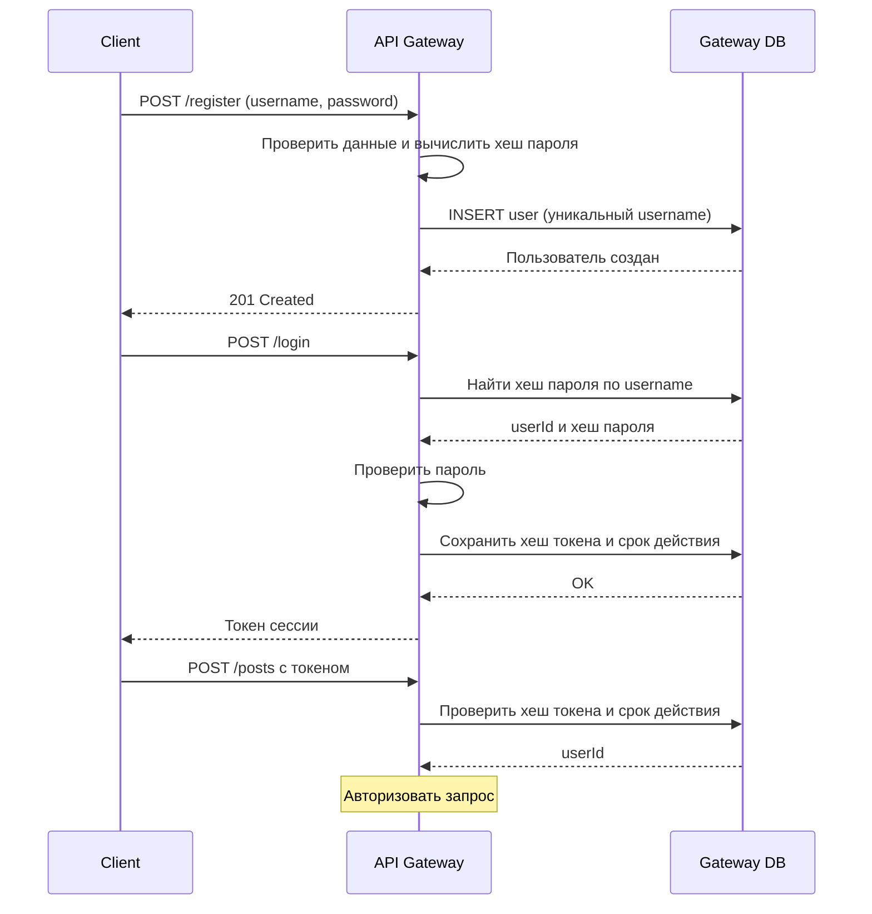
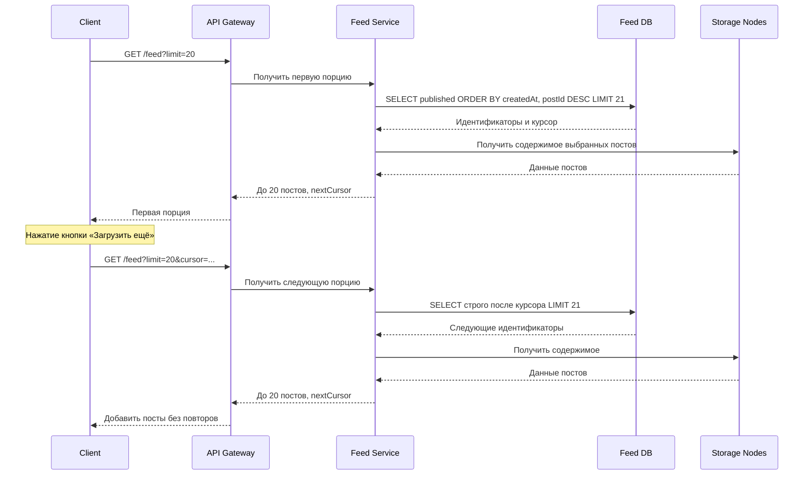
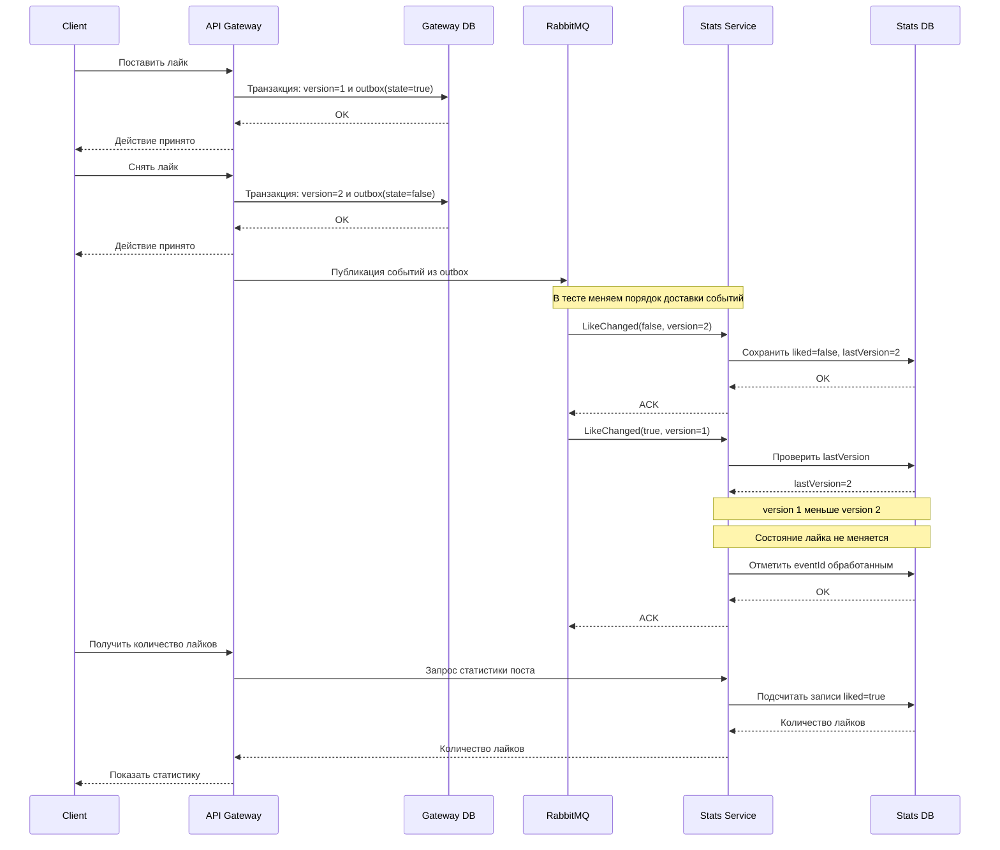

# Техническое решение проекта «MiniFeed»

## Введение
- **Краткое описание:**
 
  «MiniFeed» — учебный проект, в котором мы делаем прототип распределённой системы для публикации контента. Пользователи смотрят общую ленту и количество просмотров постов, а после регистрации и входа по имени и паролю создают короткие текстовые посты, ставят и убирают лайки и пишут комментарии.
Система разделена на несколько компонентов. Посты и комментарии хранятся на нескольких узлах хранения с копиями (репликами), а лайки и просмотры обрабатываются отдельным сервисом статистики через брокер сообщений. На этом примере мы показываем типичные проблемы распределённых систем: отказ одного узла, потерю и повторную доставку сообщений, разный порядок прихода событий и временную рассогласованность данных. 
- **Цель проекта:**  
  реализовать прототип распределённой платформы публикации контента, которая хранит посты на нескольких узлах, продолжает работать при отказе одного узла и корректно считает лайки и просмотры при повторной доставке и перестановке событий.
- **Задачи:**  
  •закрепить теорию по распределённым системам на практике;
  
  •разделить систему на несколько независимых компонентов;
  
  •распределить посты по узлам хранения и сделать их копии для отказоустойчивости;
  
  •передавать события лайков и просмотров асинхронно через брокер сообщений;
  
  •обработать ненадёжную и повторную доставку событий (at-least-once, идемпотентность, дедупликация);
  
  •обработать частичные отказы: недоступность узла хранения или сервиса статистики;
  
  •обработать разный порядок прихода событий (например, «снять лайк» пришло раньше «поставить лайк»);
  
  •использовать eventual consistency для данных, которым не нужна мгновенная согласованность (счётчики, копии постов).
- **Команда:**  
  •Бондаренко Артём Сергеевич, разработчик Feed Service (размещение данных, репликация, отказоустойчивость, лента)
  
  •Курбатская Злата Сергеевна, разработчик узлов хранения и комментариев
  
  •Рачугин Егор Олегович, разработчик событий и статистики (брокер, сервис статистики)
  
  •Баженова Наталья Антоновна, разработчик API Gateway, клиентского приложения, инфраструктуры и тестирования  

---

## Глоссарий

| Термин | Определение |
|---|---|
| Пользователь | Участник системы, который создаёт и просматривает посты, пишет комментарии и работает с лайками. |
| Учётная запись | Данные пользователя в системе: имя пользователя и пароль. |
| Имя пользователя | Уникальное в системе имя, по которому пользователь идентифицируется. |
| Пароль | Секретная строка, подтверждающая, что вход выполняет владелец учётной записи. |
| Пост | Созданная пользователем единица контента, содержащая текст. |
| Лента | Общий список постов, отображаемый пользователю в порядке от новых к старым. |
| Комментарий | Текстовое сообщение пользователя, относящееся к определённому посту. |
| Лайк | Положительная реакция пользователя на пост. |
| Просмотр | Факт открытия поста, который учитывается в статистике. |
| Статистика | Количество лайков и просмотров поста. |

---

## Функциональные требования

Система должна предоставлять следующие функции:

1. Регистрация пользователя.
2. Вход пользователя в систему.
3. Создание поста пользователем.
4. Просмотр общей ленты постов.
5. Просмотр отдельного поста.
6. Добавление лайка к посту.
7. Удаление ранее поставленного лайка.
8. Добавление комментария к посту.
9. Просмотр комментариев к посту.
10. Просмотр количества лайков поста.
11. Учёт просмотра поста.
12. Просмотр количества просмотров поста.

### Ограничения на предметную область

1. Посты и комментарии содержат только текст: пост — до 500 символов,
   комментарий — до 300 символов. Картинки, видео и файлы не
   поддерживаются.

2. Пользователь регистрируется, указав имя пользователя и пароль, и
   входит в систему с этими данными. Имя пользователя уникально:
   зарегистрировать второго пользователя с уже занятым именем нельзя. Имя
   регистрозависимое, длиной 3–15 символов. Пароль должен содержать от 6
   до 20 символов. Восстановление и смена пароля не поддерживаются.

3. Один пользователь может поставить на один пост не более одного
   лайка. Пользователь может убрать только свой лайк.

4. Посты и комментарии после создания нельзя редактировать или удалять.

5. Комментарии являются плоскими: ответить непосредственно на другой
   комментарий нельзя.

6. Используется одна общая лента. Персональные рекомендации,
   подписки, личные сообщения, поиск и теги не входят в текущий объём
   проекта.

7. Каждое открытие поста считается отдельным просмотром, в том числе
   повторное открытие того же поста.

8. Лента отображается порциями по 20 постов. Следующую порцию
   пользователь загружает явным действием — нажатием кнопки
   «Загрузить ещё» под последним отображаемым постом. Автоматической
   подгрузки при прокрутке нет. При подгрузке следующей порции уже
   показанные посты не должны дублироваться. Посты в каждой порции
   упорядочены от новых к старым.

9. Статистика лайков и просмотров может обновляться с небольшой
   задержкой. Пользовательские операции с контентом не должны зависеть
   от мгновенного обновления этих счётчиков.

10. Без входа доступны просмотр ленты, постов, комментариев и
    статистики. Создавать посты и комментарии, ставить и снимать лайки
    могут только вошедшие пользователи. При попытке выполнить такое
    действие без входа система сообщает об ошибке.

---

## Нефункциональные требования

### Надёжность

Основные пользовательские операции должны продолжать выполняться при
временном отказе отдельной части системы. Перечень таких операций
приведён в разделе «Отказоустойчивость».

Ошибка одной операции не должна приводить к потере уже сохранённых
данных.

### Асинхронность обработки

Обработка статистики не должна блокировать получение поста, ленты или
комментариев.

Задержка обработки статистики допустима, если она не нарушает
корректность итогового состояния.

### Сохранность операций

Операции, успешное принятие которых система подтвердила пользователю, не
должны теряться из-за временной остановки их дальнейшей обработки и
должны сохраняться до восстановления возможности их обработки.

Если принять операцию невозможно, пользователь получает сообщение об
ошибке.

После восстановления обработки накопленные операции должны быть
обработаны.

Повторная обработка уже обработанной операции не должна приводить
к повторному изменению итогового состояния.

### Идемпотентность

Повторная обработка одной и той же операции (в том числе при повторной
доставке сообщения о ней) должна давать тот же итоговый результат, что и
её однократная обработка.

Требование относится именно к повторной обработке одной и той же операции,
а не к отдельным действиям пользователя с одинаковыми параметрами. Так,
два отдельных открытия одного поста являются двумя
просмотрами (см. ограничение 7), а повторная доставка операции об одном
открытии поста должна привести к учёту только одного просмотра.

В частности:

- повторная доставка операции о постановке лайка не должна создавать
  несколько лайков;
- повторная доставка операции о снятии лайка не должна изменять
  состояние после первой обработки;
- повторная доставка операции об одном открытии поста не должна
  приводить к учёту более одного просмотра;
- повторная обработка одной и той же операции не должна повторно
  изменять итоговое состояние.

### Корректность порядка операций

Для лайков: для действий одного пользователя над одним постом
(постановка и снятие лайка) система устанавливает порядок принятых
изменений. Итоговое состояние лайка должно соответствовать последнему
принятому изменению в этом порядке, даже если сообщения о них поступают
на обработку в другом порядке.

Для просмотров и комментариев: порядок поступления операций на обработку
не должен влиять на итоговый результат. Должны быть учтены все просмотры
поста (каждое открытие является отдельным просмотром) и сохранены все
комментарии пользователя, а не только последнее действие.

### Согласованность данных

Счётчики лайков и просмотров могут временно отличаться от фактического
состояния сразу после действия пользователя.

После завершения обработки накопленных операций статистика должна прийти
к актуальному значению.

Копии постов и комментариев на разных узлах хранения также могут временно
отличаться друг от друга. После восстановления узла и завершения
синхронизации ранее принятые посты и комментарии должны присутствовать на
всех предназначенных для них копиях.

### Отказоустойчивость

Отказ отдельной части системы не должен приводить к полной
недоступности основных пользовательских функций.

При отказе одного узла хранения пользователь по-прежнему может создавать
посты, просматривать ленту и отдельные посты, добавлять комментарии и
просматривать комментарии к постам, ставить и убирать лайки, а также
открывать посты с учётом просмотров.

При отказе одного узла хранения пользователь по-прежнему может
регистрироваться и входить в систему.

При временной остановке обработки статистики пользователь по-прежнему
может создавать посты, просматривать ленту, отдельные посты и комментарии,
добавлять комментарии. Действия с лайками и открытия постов принимаются
системой и учитываются в статистике после восстановления обработки. При
этом значения счётчиков могут отставать от фактических.

При полной недоступности статистики значения счётчиков допускается
временно не показывать. Возможность принимать новые лайки и открытия
постов зависит от доступности компонента, который их сохраняет.

Если система не может безопасно принять операцию, она сообщает
пользователю об ошибке. Успешное создание поста, комментария или лайка не
показывается, если операция фактически не принята.

После восстановления работы системы накопленные данные и операции
должны быть обработаны без потери и без повторного изменения итогового
состояния.

### Предсказуемость поведения

Для одинаковой последовательности пользовательских действий система
должна выдавать одинаковый итоговый результат независимо от временных
задержек обработки.

### Защита паролей

Пароли не должны храниться в открытом виде и не передаются другим
пользователям. Для проверки паролей используются их защищённые хеши.

---

## Пользовательские сценарии

### Сценарий: регистрация

1. Пользователь вводит имя пользователя и пароль.
2. Клиентское приложение передаёт данные в систему.
3. Система проверяет, что имя не занято и данные соответствуют
   ограничениям.
4. Система создаёт учётную запись, пользователь получает подтверждение.
5. Если имя занято, система сообщает об ошибке, учётная запись не
   создаётся.

### Сценарий: вход пользователя

1. Пользователь вводит имя пользователя и пароль.
2. Система проверяет, что пароль соответствует учётной записи.
3. При совпадении пользователь получает доступ к функциям системы.
4. При несовпадении система сообщает об ошибке, доступ не
   предоставляется.

### Сценарий: создание поста

1. Пользователь выбирает создание нового поста и вводит текст.
2. Клиентское приложение отправляет запрос на создание поста.
3. Система сохраняет пост.
4. Пользователь получает подтверждение.
5. Пост появляется в общей ленте.

### Сценарий: просмотр общей ленты

1. Пользователь открывает общую ленту.
2. Клиентское приложение запрашивает список постов.
3. Система показывает первые 20 постов от новых к старым.
4. Пользователь просматривает ленту.
5. При необходимости пользователь нажимает кнопку «Загрузить ещё».
6. Система загружает следующую порцию из 20 постов и добавляет её к
   уже отображаемой ленте.

### Сценарий: просмотр поста

1. Пользователь выбирает пост в ленте.
2. Клиентское приложение запрашивает пост.
3. Система возвращает содержимое поста, количество лайков и количество
   просмотров.
4. Открытие поста учитывается как отдельный просмотр.
5. При повторном открытии того же поста также фиксируется новый
   просмотр.
6. После завершения обработки событий счётчики приходят к актуальным
   значениям. Сразу после действия допускается небольшая задержка.

### Сценарий: добавление лайка

1. Пользователь открывает пост и нажимает «Нравится».
2. Клиентское приложение отправляет запрос на добавление лайка.
3. Система сохраняет лайк пользователя для выбранного поста.
4. Пользователь видит, что лайк установлен.

### Сценарий: удаление лайка

1. Пользователь открывает пост, которому ранее поставил лайк, и
   нажимает «Убрать лайк».
2. Клиентское приложение отправляет запрос на удаление лайка.
3. Система удаляет лайк пользователя для выбранного поста.
4. Пользователь видит, что его лайк снят.

### Сценарий: добавление комментария

1. Пользователь открывает пост и вводит текст комментария.
2. Клиентское приложение отправляет запрос на создание комментария.
3. Система сохраняет комментарий, связанный с постом и пользователем.
4. Пользователь получает подтверждение.
5. Комментарий становится виден в списке комментариев поста.

### Сценарий: просмотр комментариев

1. Пользователь открывает пост.
2. Клиентское приложение запрашивает комментарии к посту.
3. Система возвращает список комментариев от старых к новым.
4. Пользователь видит комментарии.

---

## Архитектура системы

Для реализации проекта выбирается небольшая сервисная архитектура, которую можно полностью запустить локально через Docker Compose. Основная логика распределённости реализуется на уровне наших сервисов, а не перекладывается целиком на готовую распределённую СУБД.

Основные компоненты:

1. **Client** — простое веб-приложение пользователя. Позволяет зарегистрироваться и войти в систему, просматривать ленту и отдельные посты, создавать посты и комментарии, ставить и снимать лайки.
2. **API Gateway** — единая точка входа для клиентских запросов. Проверяет авторизацию, маршрутизирует запросы в остальные компоненты, формирует уникальные идентификаторы операций и сохраняет события лайков и просмотров перед их асинхронной отправкой.
3. **Gateway DB** — локальная база API Gateway. Хранит учётные записи пользователей, защищённые хеши паролей, сессии с ограниченным сроком действия, outbox для событий лайков и просмотров и версии принятых операций лайка для каждой пары пользователь–пост.
4. **Feed Service** — сервис работы с постами, комментариями и общей лентой. Выбирает узлы хранения для поста, выполняет запись копий, переключается на доступную копию при отказе узла и запускает восстановление недостающих копий.
5. **Feed DB** — локальная база Feed Service. Хранит индекс общей ленты и служебной информацией о постах. При создании поста сначала сохраняется запись со статусом pending, содержащая postId, автора, текст и время создания. После успешного сохранения поста хотя бы на одном предназначенном узле хранения его статус меняется на published. В общуюю ленту попадают только посты с этим статусом. Незавершенные операции со статусом pending обрабатываются повторно после восстановления Feed Service.
6. **Storage Node 1..3** — три одинаковых узла хранения. Каждый узел имеет собственную локальную базу и хранит часть постов и комментариев.
7. **Message Broker** — RabbitMQ. Используется для асинхронной передачи событий лайков и просмотров.
8. **Stats Service** — сервис статистики. Получает события из брокера, выполняет дедупликацию и обновляет состояние лайков и счётчики просмотров.
9. **Stats DB** — локальная база сервиса статистики. Хранит количество просмотров постов, состояние лайков пользователей, последние применённые версии операций лайка и идентификаторы обработанных событий. Для каждой пары userId–postId хранится не более одной записи о состоянии лайка. Общее количество лайков поста вычисляется по числу активных лайков.

Для учебного прототипа сервисы планируется реализовать на Python с FastAPI. Локальные данные сервисов хранятся в SQLite, а запуск всей системы выполняется через Docker Compose. Такой выбор позволяет сосредоточиться на логике распределённой системы и не усложнять проект администрированием нескольких полноценных СУБД.

~~~mermaid
graph TD
    Client[Client]

    subgraph Entry
        Gateway[API Gateway]
        GatewayDB[(Gateway DB)]
    end

    subgraph Content
        Feed[Feed Service]
        FeedDB[(Feed DB)]
        Node1[Storage Node 1]
        Node2[Storage Node 2]
        Node3[Storage Node 3]
    end

    subgraph Statistics
        Broker[Message Broker / RabbitMQ]
        Stats[Stats Service]
        StatsDB[(Stats DB)]
    end

    Client -->|HTTP/REST| Gateway
    Gateway -->|users, outbox| GatewayDB
    Gateway -->|HTTP/REST| Feed
    Gateway -->|получение счётчиков| Stats

    Feed --> FeedDB
    Feed -->|HTTP/REST| Node1
    Feed -->|HTTP/REST| Node2
    Feed -->|HTTP/REST| Node3

    Gateway -->|события из outbox| Broker
    Broker -->|at-least-once| Stats
    Stats --> StatsDB
~~~

### Размещение постов, репликация и восстановление копий

- **Проблема:** один узел хранения может стать недоступным, а объём данных не должен целиком находиться на одном узле.
- **Решение:** используются три узла хранения. Для каждого поста Feed Service определяет основной узел с помощью стабильной хеш-функции SHA-256 от postId. Полученное хеш-значение преобразуется в целое число, после чего вычисляется остаток от деления на 3. Результат определяет основной узел хранения. Вторая копия размещается на следующем узле по кругу. Таким образом, каждый пост хранится на двух из трёх узлов. Комментарии размещаются на тех же узлах, что и соответствующий пост. Использование SHA-256 обеспечивает одинаковое размещение данных при повторных вычислениях и перезапусках сервисов. Количество узлов фиксировано и в текущей версии проекта не изменяется.
- **Запись:** при обычной работе пост или комментарий записывается на оба предназначенных узла хранения. Если один из них недоступен, запись может быть подтверждена после успешного сохранения данных на втором узле, а отсутствующая копия восстанавливается при последующей фоновой синхронизации.
- **Чтение постов:** Feed Service сначала обращается к основному узлу хранения, если узел недоступен или пост на нем отсутсвует, запрос направляется ко второй копии. Поскольку посты после создания не изменяются, дополнительное согласование их содержимого не требуется.
- **Чтение комментариев:** Feed Service запрашивает комментарии обих узлов хранения, на которых размещен соответствующий пост. Полученные списки объединяются по уникальному идентификатору commentId, повторяющиеся записи исключаются. Результат сортируется по времени создания комменатриев от старых к новым. Еси один узел недоступен, используется данные доступного узла.
- **Согласованность при чтении:** если один из узлов раннее был недоступен и пропустил новые комментарии, при чтениии с двух доступных узлов пользователь получает объединенный список. Так, возвращение устаревшего узла не приводит к исчезновению уже сохраненных комментариев из результата чтения.
- **Восстановление:** Feed Service периодически проверяет доступные узлы хранения и сравнивает идентификаторы постов и комментариев, которые должны находиться на соответствующих узлах. Если на одном из узлов отсутствует запись, которая есть на другом, Feed Service коирует недостающие данные. Проверка выполняется также после восстановления ранее недоступного узла.Благодаря этому копии постепенно синхронизируются даже без пользовательских запросов. Послькольку посты и комментарии после создания не изменяются и не удаляются, разрешение конфликтующих изменений не требуется.
- **Read repair:** дополнительное восстановление выполняется во время чтения. Если Feed Service обнаруживает, что на одном из доступных узлов отсутствует пост или часть комментариев, недостоющие записи копируются с другого узла.Основным механизмом восстановления остается переодическая фоновая синхронизация, поэтому восстановление копий не зависит от активности пользователей.
- **Гарантия:** отказ одного Storage Node не приводит к потере уже подтверждённых постов и комментариев и не блокирует операции с контентом, если доступна вторая копия.
- **Компромиссы:** при работе с одним доступным экземпляром данных временно уменьшается число копий. Проект не решает отказ двух узлов одновременно и не реализует динамическое добавление узлов без перераспределения данных.

### Асинхронная доставка событий и outbox

- **Проблема:** Stats Service или Message Broker могут временно не отвечать, а сообщение может быть доставлено повторно, задерживаться или теряться.
- **Решение:** события лайков и просмотров сначала сохраняются в outbox API Gateway вместе с уникальным eventId. Фоновый отправитель пытается передать их  в RabbitMQ. Если брокер недоступен или отправка не подтверждена, событие остаётся в outbox и отправляется повторно.
- **Сохранность сообщений:** в RabbitMQ используется durable queue и persistent messages. Отправитель использует publisher confirms и помечает событие в outbox как отправленное только после подтверждения брокера.
- **Обработка:** Stats Service получает события из RabbitMQ и обрабатывает их с ручным подтверждением (manual ACK). Подтверждения отправляются только после успешного сохранения результата обработки в Stats DB. Если обработка завершилась ошибой, сообщение остается не подтвержденным и может быть доставленно повторно.
- **Дедупликация:** Stats Service сохраняет eventId обработанных событий. Изменения статистики и сохранения evenId выполняются в одной транзации. Если событие с таким eventId уже обработанно, повторная доставка не изменяет статистику.
- **Гарантия:** временная недоступность Stats Service или RebbitMQ принятые события сохраняются и обрабатываются после восстановления компонентов. Повторная доставка не приводит к повторному изменению статистики.
- **Компромиссы:** используется семантика at-least-once, поэтому повторная доставка допстима. Счетчики могут обновляться с задержкой. Гарантия сохранности предполагает сохранение локальных баз данных и постоянного хранилища RabbitMQ; одновременная безвозвратная потеря этих хранилищ не рассматривается.

### Порядок операций с лайком

- **Проблема:** пользователь может последовательно поставить и снять лайк, однако события об этих действиях могут поступить в Stats Service в другом порядке или быть доставлены повторно. Это не должно приводить к неправильному состоянию лайка или количеству лайков поста.
- **Решение:** API Gateway устанавливает порядок действий для каждой пары userId–postId. При принятии нового действия номер likeVersion увеличивается на единицу. Новая версия и событие LikeChanged с уникальным eventId сохраняются в Gateway DB одной локальной транзакцией. Событие содержит userId, postId, новое состояние лайка и likeVersion.
- **Хранение лайков:** Stats Service хранит в Stats DB одну запись для каждой пары userId–postId. Запись содержит текущее состояние liked и номер последней применённой версии lastVersion. Уникальность пары userId–postId обеспечивается ограничением базы данных
- **Обработка событий:** при получении LikeChanged сервис сравнивает likeVersion с lastVersion. Если новая версия больше сохранённой, состояние liked и lastVersion обновляются. Если версия меньше или равна сохранённой, состояние не изменяется. Проверка eventId, обновление состояния и сохранение информации об обработке события выполняются в одной транзакции Stats DB.
- **Подсчёт лайков:** количество лайков поста определяется по числу записей с соответствующим postId и liked=true. Отдельный счётчик лайков не хранится, поэтому повторная обработка одного события не может увеличить его значение.
- **Гарантия:** у одного пользователя может быть не более одного активного лайка на одном посте. Итоговое состояние определяется последней принятой операцией пользователя независимо от порядка доставки событий. Повторная доставка не изменяет результат.
- **Компромиссы:** информация о лайках обновляется асинхронно и может временно отставать от действий пользователя. Вычисление количества лайков по записям требует обращения к базе данных, но для небольшого учебного проекта это допустимо. Порядок пользовательских операций устанавливается одним API Gateway, распределённая координация нескольких экземпляров API Gateway не реализуется.

### Учёт просмотров

- **Проблема:** два разных открытия одного поста должны считаться двумя просмотрами, однако повторная доставка события одного открытия не должна увеличивать счётчик дважды.
- **Решение:** для каждого открытия создаётся новый eventId. При повторной доставке сохраняется тот же eventId.
- **Обработка:** Stats Service увеличивает счётчик только для ранее не обработанного eventId.
- **Гарантия:** два отдельных открытия дают два просмотра, а повторная доставка одного события учитывается один раз.
- **Компромиссы:** просмотры считаются по факту открытия поста, а не по уникальным пользователям.

### Частичные отказы и eventual consistency

- **Проблема:** в распределённой системе разные компоненты могут быть временно недоступны независимо друг от друга.
- **Решение для узла хранения:** Feed Service обнаруживает отсутствие ответа по таймауту и использует вторую копию данных. После восстановления узла выполняется синхронизация недостающих данных.
- **Решение для статистики:** если Stats Service остановлен, события продолжают храниться в outbox и/или очереди брокера. Работа с постами и комментариями продолжается. При чтении счётчиков API Gateway использует короткий таймаут и при недоступности статистики возвращает контент без счётчиков.
- **Гарантия:** временный отказ одного узла хранения или обработчика статистики не приводит к полной недоступности MiniFeed. После восстановления и обработки накопившихся данных копии контента и статистика сходятся к актуальному состоянию.
- **Компромиссы:** в период отказа пользователь может видеть устаревшие счётчики либо не видеть их вовсе. Высокая доступность API Gateway, Feed Service, RabbitMQ и их локальных баз в текущем учебном проекте отдельно не реализуется.

---

## Технические сценарии

### Сценарий: регистрация и вход пользователя

1. Клиент отправляет `POST /register` с именем пользователя и паролем.
2. API Gateway проверяет ограничения на длину имени и пароля, создаёт `userId` и защищённый хеш пароля с индивидуальной солью (Argon2id).
3. API Gateway пытается сохранить пользователя в Gateway DB. Уникальное ограничение на поле `username` не позволяет одновременно создать две учётные записи с одним именем. При конфликте возвращается ошибка регистрации.
4. Для входа клиент отправляет `POST /login` с именем и паролем. API Gateway получает хеш из Gateway DB и проверяет пароль.
5. При успешной проверке API Gateway создаёт случайный токен сессии, сохраняет в Gateway DB его хеш, `userId` и срок действия; сам токен возвращает клиенту.
6. При создании поста, комментария или изменении лайка клиент передаёт токен в заголовке `Authorization`. API Gateway проверяет срок действия сессии и соответствие хеша токена в Gateway DB.
7. Если имя занято, пароль неверен или сессия недействительна, соответствующая операция отклоняется. Просмотр публичных постов и ленты не требует входа.

### Сценарий: получение общей ленты с пагинацией

1. Клиент отправляет `GET /feed?limit=20` в API Gateway, который передаёт запрос в Feed Service.
2. Feed Service выбирает в Feed DB опубликованные посты (`status=published`), отсортированные по `createdAt DESC, postId DESC`. Выбирается до 21 записи: 20 для выдачи, дополнительная запись для определения наличия следующей порции.
3. По `postId` Feed Service определяет два узла хранения каждого поста и загружает текст с доступной копии. При таймауте основного узла используется резервный.
4. Feed Service возвращает до 20 постов и, если есть следующая порция, курсор на основе пары `createdAt` и `postId` последней выданной записи.
5. После нажатия кнопки «Загрузить ещё» клиент отправляет `GET /feed?limit=20&cursor={cursor}`.
6. Feed Service выбирает записи строго после курсора: с меньшим `createdAt`, либо с тем же `createdAt` и меньшим `postId`. Клиент добавляет полученную порцию к уже показанной ленте.
7. Если дополнительных записей нет, сервер возвращает признак окончания ленты. Новые публикации, появившиеся между запросами, не дублируют ранее показанные посты.

### Сценарий: создание поста с репликацией

1. Авторизованный клиент отправляет POST /posts с текстом поста в API Gateway.
2. API Gateway проверяет авторизацию пользователя и передаёт запрос в Feed Service.
3. Feed Service создаёт уникальный postId и сохраняет информацию о посте в Feed DB со статусом pending.
4. Feed Service вычисляет SHA-256 от postId и по остатку от деления полученного значения на 3 определяет основной узел хранения. Вторым выбирается следующий узел по кругу. Полученная пара узлов используется для сохранения поста и его последующего чтения.
5. Feed Service отправляет пост на оба выбранных узла. Каждый узел сохраняет запись по postId. Повторная запись с тем же postId не создает дубликат.
6. После успешного сохранения поста хотя бы на одном узле Feed Service меняет его статус в Feed DB на published. Если второй узел недоступен, его копия восстанавливается при последующей фоновой синхронизации.
7. В общей ленте отображаются только посты со статусом published.
8. API Gateway возвращает клиенту подтвержение успешного создания поста только после перехода в состояние published.
9. Если Feed Service отключается во время создания поста, после перезапуска он находит записи со статусом pending и повторяет незавершенные операции с теми же postId.
10. Если ни один из предназначенных узлов хранения не подтвердил сохранение поста, публикация не считается завершенной и пользователь не получает сообщение об успешном создании поста.

~~~mermaid
sequenceDiagram
    participant Client
    participant Gateway as API Gateway
    participant Feed as Feed Service
    participant FeedDB as Feed DB
    participant Primary as Storage Primary
    participant Node1 as Storage Node 1
    participant Node2 as Storage Node 2

    Client->>Gateway: POST /posts
    Gateway->>Feed: создать пост
    Feed->>FeedDB: Сохранить postId, status=pending
    FeedDB->>Feed: OK

    Feed->>Note1: сохранить пост по postId
    Note1-->>Feed: OK

    Feed->>Note2: сохранить копию поста
    Note2-->>Feed: OK

    Feed->>FeedDB: Изменить статус на published
    FeedDB->>Feed: OK

    Feed-->>Gateway: пост опубликован
    Gateway-->>Client: 201 Created

    Note over Feed, FeedDB: после сбоя pending-записи обрабатываются повторно
~~~

### Сценарий: чтение поста при отказе основного узла

1. Клиент запрашивает GET /posts/{postId}.
2. API Gateway передаёт запрос в Feed Service.
3. Feed Service определяет основной узел и реплику для postId.
4. Основной узел не отвечает до истечения таймаута.
5. Feed Service обращается к реплике и получает пост.
6. API Gateway дополнительно запрашивает текущие счётчики у Stats Service. Если статистика недоступна, пост возвращается без счётчиков.
7. Клиент получает пост.
8. После восстановления основного узла Feed Service при чтении или отдельной синхронизации восстанавливает отсутствующую либо устаревшую копию.

~~~mermaid
sequenceDiagram
    participant Client
    participant Gateway as API Gateway
    participant Feed as Feed Service
    participant Primary as Storage Primary
    participant Replica as Storage Replica

    Client->>Gateway: GET /posts/{postId}
    Gateway->>Feed: получить пост
    Feed->>Primary: GET post
    Primary--xFeed: timeout
    Feed->>Replica: GET post
    Replica-->>Feed: post
    Feed-->>Gateway: post
    Gateway-->>Client: 200 OK
~~~

### Сценарий: создание комментария при недоступности одной копии

1. Авторизованный клиент отправляет POST /posts/{postId}/comments.
2. Feed Service по postId определяет два узла, на которых должны находиться пост и его комментарии.
3. Комментарий получает уникальный commentId.
4. Feed Service пытается записать комментарий на оба узла.
5. Если один узел недоступен, комментарий сохраняется на доступном узле, а для второго создаётся отметка о необходимости восстановления.
6. После возвращения узла недостающий комментарий копируется на него.
7. Повторное сохранение того же commentId не создаёт второй комментарий.

### Сценарий: просмотр поста и повторная доставка события

1. Клиент запрашивает пост.
2. После успешного получения поста API Gateway создаёт событие PostViewed с новым eventId и сохраняет его в outbox.
3. Фоновый отправитель передаёт событие в RabbitMQ.
4. RabbitMQ доставляет событие Stats Service. При отсутствии подтверждения доставка может повториться.
5. Stats Service в одной транзакции проверяет eventId, увеличивает счётчик просмотров и отмечает eventId обработанным.
6. Если то же событие приходит повторно, его eventId уже существует и счётчик второй раз не увеличивается.
7. При следующем отдельном открытии создаётся другой eventId, поэтому новый просмотр учитывается.

~~~mermaid
sequenceDiagram
    participant Gateway as API Gateway
    participant Outbox as Gateway DB / Outbox
    participant Broker as RabbitMQ
    participant Stats as Stats Service
    participant StatsDB as Stats DB

    Gateway->>Outbox: сохранить PostViewed(eventId)
    Outbox->>Broker: публикация события
    Broker->>Stats: PostViewed(eventId)
    Stats->>StatsDB: проверить eventId + увеличить views
    StatsDB-->>Stats: OK
    Stats-->>Broker: ACK
    Broker->>Stats: повтор PostViewed(eventId)
    Stats->>StatsDB: eventId уже обработан
    Stats-->>Broker: ACK без изменения счётчика
~~~

### Сценарий: лайк и снятие лайка приходят в обратном порядке

1. Авторизованный пользователь ставит лайк посту. API Gateway принимает действие и определяет для пары userId–postId следующую версию likeVersion=1.
2. API Gateway одной транзакцией сохраняет новую версию и событие LikeChanged(state=true, version=1) в outbox.
3. Пользователь снимает лайк с того же поста. API Gateway принимает действие и сохраняет LikeChanged(state=false, version=2) вместе с новой версией.
4. Фоновый отправитель передаёт события из outbox в RabbitMQ.
5. Из-за задержек или повторной доставки Stats Service сначала получает событие с version=2.
6. Stats Service проверяет текущую версию для пары userId–postId. Поскольку более новой версии ещё нет, сервис сохраняет liked=false и lastVersion=2.
7. Затем Stats Service получает событие с version=1.
8. Сервис сравнивает версии и обнаруживает, что version=1 меньше сохранённой lastVersion=2. Устаревшее событие не изменяет состояние лайка.
9. Обработка каждого события и сохранение его eventId выполняются в одной локальной транзакции.
10. При запросе количества лайков Stats Service подсчитывает активные лайки пользователей для указанного поста.
11. Итоговое состояние соответствует последнему принятому действию пользователя: лайк снят, и пользователь не учитывается в количестве лайков поста.

### Сценарий: временная остановка Stats Service

1. Stats Service останавливается.
2. Пользователь продолжает просматривать посты, создавать посты и комментарии.
3. События просмотров и лайков сохраняются в outbox и передаются в RabbitMQ, где ожидают обработки.
4. Содержимое постов и комментариев остаётся доступным. Значения счётчиков могут быть устаревшими или временно не отображаться.
5. Stats Service запускается снова.
6. Он получает накопившиеся события из RabbitMQ.
7. Дубликаты отбрасываются по eventId, а события лайков применяются с учётом likeVersion.
8. После обработки очереди статистика приходит к актуальному состоянию.

---

## План разработки и тестирования

### План разработки

1. **Подготовка инфраструктуры**
   - создать структуру сервисов;
   - настроить Docker Compose;
   - добавить RabbitMQ и постоянные тома для локальных баз.

2. **API Gateway и пользователи**
   - реализовать регистрацию и вход;
   - хранить пароли только в виде защищённых хешей;
   - реализовать проверку авторизации для действий, требующих входа;
   - реализовать создание и проверку сессий с ограниченным сроком действия;
   - реализовать outbox и генерацию eventId;
   - реализовать версии операций лайка для пары userId–postId.

3. **Storage Node**
   - реализовать единый сервис узла хранения;
   - реализовать хранение постов и комментариев;
   - обеспечить идемпотентную запись по postId и commentId;
   - запускать три экземпляра сервиса с независимыми локальными базами.

4. **Feed Service**
   - реализовать создание postId и hash-размещение постов;
   - реализовать две копии каждого поста и комментариев;
   - реализовать индекс общей ленты и загрузку по 20 постов;
   - реализовать таймаут и переключение на вторую копию;
   - реализовать отметки о недостающих копиях и read repair.

5. **Stats Service**
   - подключить RabbitMQ;
   - реализовать обработку PostViewed и LikeChanged;
   - реализовать дедупликацию по eventId;
   - реализовать обработку likeVersion;
   - реализовать выдачу количества просмотров и лайков.

6. **Клиентское приложение**
   - реализовать регистрацию и вход;
   - реализовать общую ленту и кнопку «Загрузить ещё»;
   - реализовать просмотр и создание постов;
   - реализовать комментарии;
   - реализовать постановку и снятие лайка;
   - корректно отображать состояние, когда статистика временно недоступна.

7. **Интеграция и подготовка демонстрации**
   - связать все компоненты;
   - добавить подготовку тестовых данных;
   - добавить сценарии остановки отдельных компонентов;
   - описать команды запуска и демонстрации в README.

### План тестирования

- **Функциональные тесты**
  - регистрация пользователя с уникальным именем;
  - отказ регистрации с занятым именем;
  - успешный и неуспешный вход;
  - создание и просмотр поста;
  - загрузка ленты порциями по 20 постов без дублей;
  - создание и просмотр комментариев;
  - постановка и снятие лайка;
  - отклонение создания поста с отсутствующим или недействительным токеном;
  - успешное создание поста после входа;
  - отсутствие дублей при загрузке следующей порции ленты;
  - отсутствие повторов, если между загрузками порций появился новый пост.

- **Тесты распределения и репликации**
  - одинаковый postId всегда отображается на одну и ту же пару узлов;
  - разные postId распределяются между тремя узлами с использованием SHA-256;
  - после перезапуска Feed Service один и тот же postId соответствует той же паре узлов хранения;
  - новый пост при нормальной работе появляется на двух узлах;
  - комментарии размещаются на тех же узлах, что и пост;
  - при остановке одного Storage Node чтение выполняется со второй копии;
  - при остановке одного Storage Node новый пост и комментарий сохраняются на доступной копии;
  - после восстановления узла read repair восстанавливает недостающие посты и комментарии.
  - тест восстановления незавершенной публикации: Feed Service останавливается после сохранения поста на узле хранения, но до изменения статуса в Feed DB. После перезапуска сервис завершает публикацию без создания дубликатов. Пост появляется в общей ленте один раз.

- **Тесты доставки событий**
  - повторная доставка одного PostViewed с тем же eventId увеличивает счётчик один раз;
  - два разных PostViewed с разными eventId увеличивают счётчик два раза;
  - повторная доставка LikeChanged не создаёт дополнительный лайк;
  - при временной недоступности RabbitMQ событие остаётся в outbox и отправляется после восстановления;
  - при временной остановке Stats Service события накапливаются и обрабатываются после запуска.
  - тест подтверждения обработки: Stats Service останавливается после сохранениярезультата обработки события в Stats DB, но до отправки ACK в RabbitMQ. После повторной доставки событие распознается по eventId, а счётчик не изменяется повторною

- **Тесты порядка событий**
  - при обработке LikeChanged(version=2) раньше LikeChanged(version=1) итоговое состояние лайка соответствует версии 2;
- повторная доставка одного события LikeChanged с тем же eventId не изменяет состояние лайка;
- повторная постановка лайка одним пользователем не создаёт второй активный лайк на том же посте;
- после последовательных действий «поставить лайк», «снять лайк», «поставить лайк» итоговое состояние соответствует последней принятой версии, а пользователь учитывается в количестве лайков только один раз.

- **Тесты деградации**
  - при остановке Stats Service лента, посты и комментарии продолжают открываться;
  - при недоступности Stats Service клиент корректно отображает отсутствие или устаревание счётчиков;
  - при остановке одного Storage Node регистрация и вход продолжают работать;
  - после восстановления компонентов данные сходятся к актуальному состоянию.

- **Модульные тесты**
  - выбор основного и резервного узла;
  - валидация ограничений постов, комментариев, имени пользователя и пароля;
  - проверка дедупликации eventId;
  - сравнение likeVersion;
  - логика пагинации ленты.

### Definition of Done (DoD)

Проект считается завершённым, если на финальном демо можно последовательно показать следующие результаты:

1. Система полностью запускается одной командой через Docker Compose.
2. Новый пользователь регистрируется и входит в систему; второй пользователь с тем же именем зарегистрироваться не может.
3. Авторизованный пользователь создаёт пост и комментарий, после чего они доступны через клиентское приложение.
4. В подготовленном наборе из более чем 20 постов первая порция ленты содержит 20 записей, а кнопка «Загрузить ещё» добавляет следующую порцию без повторов.
5. Пользователь может поставить и снять лайк, причём один пользователь не может иметь два одновременных лайка на одном посте.
6. Два отдельных открытия одного поста увеличивают число просмотров на два после завершения обработки событий.
7. Искусственная повторная доставка одного события PostViewed с тем же eventId не увеличивает счётчик повторно.
8. События постановки и снятия лайка, доставленные в обратном порядке, приводят к состоянию, соответствующему последней принятой операции.
9. После остановки Stats Service посты, лента и комментарии продолжают работать; после запуска Stats Service накопившиеся события обрабатываются, и счётчики сходятся к актуальному состоянию.
10. После остановки одного Storage Node существующие посты и комментарии читаются со второй копии, а новые посты и комментарии продолжают создаваться.
11. После возвращения Storage Node недостающие данные восстанавливаются, и обе предназначенные копии снова содержат одинаковый набор постов и комментариев.
12. Пароли пользователей не хранятся в открытом виде.

